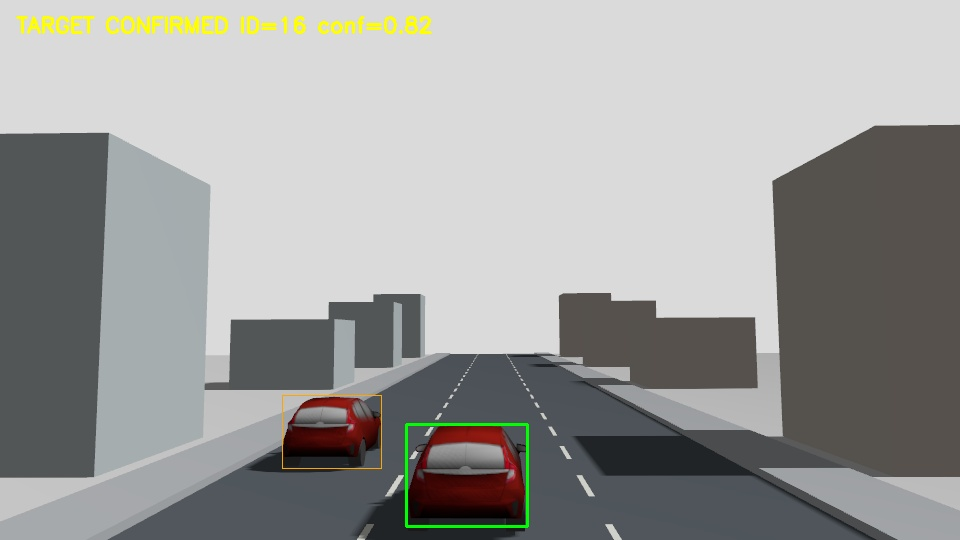
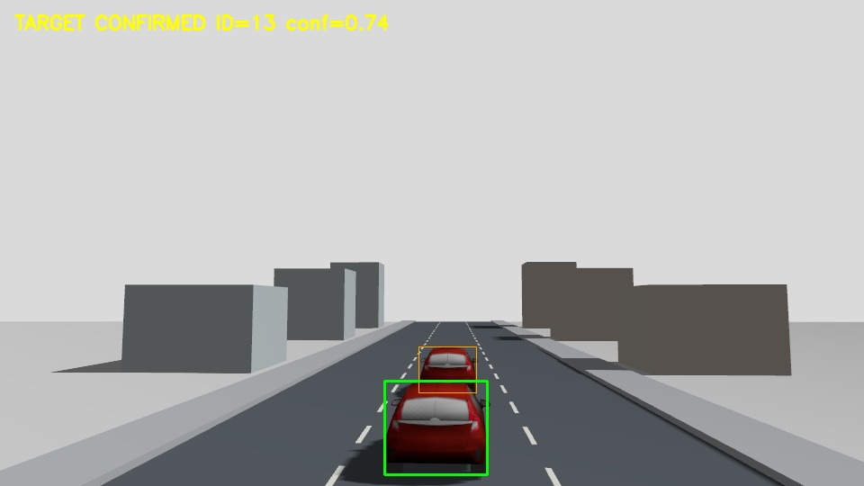
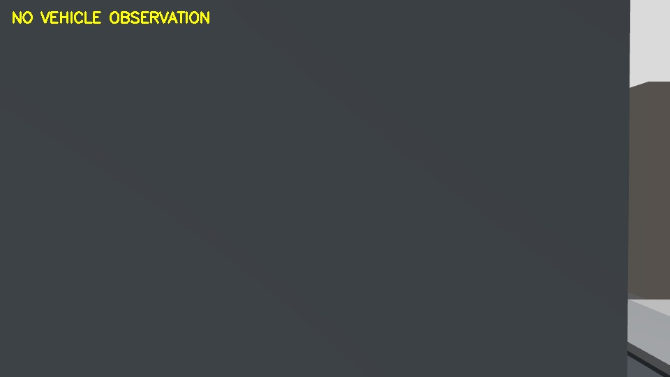
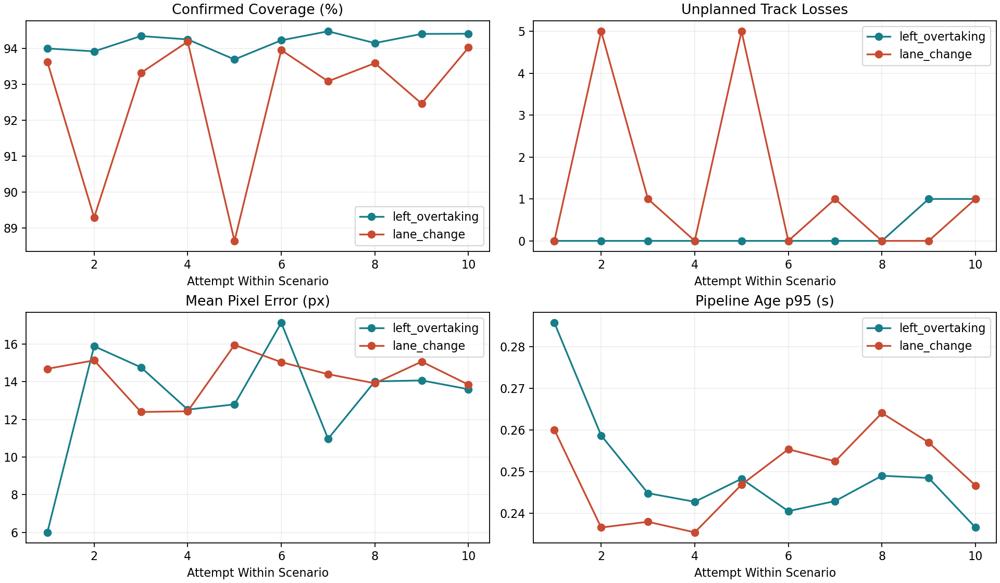

# 无人机车辆跟踪项目：30 分钟零基础介绍与代码导读

整理日期：2026-10-12。面向没有 ROS、飞控或视觉跟踪基础的读者。本文从任务和术语开始，再沿真实代码解释数据如何流动，最后介绍 Torch 与 OpenVINO 两批实验。所有数字均对应已保存结果，不把失败删去，也不将仿真写成实机成果。

## 如何使用本文

前八节是约 30 分钟的主讲流程，展示图表的时间包含在各节中；实际时长需按个人语速排练。后面的“代码导读”“结果文件导读”和答疑是详细阅读材料，不要求在 30 分钟内逐行朗读。零基础读者可以顺序阅读；希望看代码的读者先看目录树，再按推荐顺序打开文件。

每节先讲白话，再给出代码对应关系。讲稿里的教学例子只帮助理解，不冒充实验数据。本文的目标不是让读者立即理解每行 Python，而是能回答：系统在做什么，哪个模块负责，消息从哪里来，为什么会失败，以及结果能证明什么。

## 时间安排

| 时间 | 时长 | 主讲内容 |
| --- | ---: | --- |
| 00:00 至 03:00 | 3 分钟 | 项目任务与最基本术语 |
| 03:00 至 06:00 | 3 分钟 | 场景、车辆和两个时间尺度 |
| 06:00 至 11:00 | 5 分钟 | 整体架构与代码职责 |
| 11:00 至 16:00 | 5 分钟 | 检测、跟踪、身份恢复 |
| 16:00 至 21:00 | 5 分钟 | 飞行闭环、状态机和安全 |
| 21:00 至 24:00 | 3 分钟 | 主要困难及解决过程 |
| 24:00 至 28:00 | 4 分钟 | OpenVINO 接入与重复结果 |
| 28:00 至 30:00 | 2 分钟 | 项目价值、未解决问题与总结 |
| 合计 | 30 分钟 | 代码逐项导读和答疑另计 |

## 一、我们到底让无人机做什么

时间：00:00 至 03:00。

### 可以直接讲述的正文

大家好，今天介绍一个无人机车辆跟踪仿真项目。即使没有学过机器人，也可以先把任务理解成：无人机起飞，用自己的相机找到一辆车，跟着它向前走；这辆车暂时被挡住时，不立即跟错另一辆车；原车重新出现后，再确认它，最后返回起飞区域并降落。

这里的无人机、道路和车辆都在电脑里的三维环境中，不是真实街道上的飞行。这叫仿真。仿真的价值是可以重复相同任务、制造遮挡、保存完整记录，先验证算法，再考虑实物。但仿真成功不代表已经可以直接在真实道路上安全使用。

为什么这比在图片上画一个车辆方框难？因为车辆会运动，无人机也会运动。无人机一转头，整张图像都会变；附近还有其他相同颜色的车；有时相机只看到半辆车。系统必须同时解决“看见车”“知道还是原车”“根据图像运动”“看不清时怎么办”四个问题。

本项目不是把每个问题都重新发明一遍，而是使用成熟工具，再编写把它们连接成任务的代码。ROS 2 负责模块通信；Gazebo 生成三维场景和相机画面；PX4 负责无人机底层飞行；YOLO 找出车辆位置；ByteTrack 把连续图像中的车辆连接成轨迹；我们自己的目标锁进一步维护任务最初选择的那辆车。

所谓闭环，是动作之后再看结果。相机看到车偏向一侧，程序调整无人机；无人机动起来，相机得到新画面；程序再判断是否需要调整。它不是只播放一次预先写好的轨迹，也不是根据车辆的真实坐标直接追过去。

评测程序可以知道仿真里的车辆真实坐标，用它检查有没有跟错；飞行控制与感知程序不能使用这条答案。否则系统只是在按答案追车，并不能证明视觉跟踪能力。

### 先认识这些术语

| 术语 | 白话解释 | 在本项目中的作用 |
| --- | --- | --- |
| ROS 2 | 让多个机器人程序交换消息的软件框架，不是飞控 | 组织相机、感知和任务控制 |
| 节点 Node | 执行一种职责的程序组件 | 感知节点负责看图，控制节点负责决策 |
| 话题 Topic | 节点之间持续传递某类消息的通道 | 相机图像通过话题送给感知 |
| 消息 Message | 双方约定的数据格式 | 时间、车辆框、中心、置信度 |
| Gazebo | 电脑中的三维机器人实验环境 | 产生道路、车辆、无人机运动和图像 |
| PX4 / SITL | 飞控软件 / 在电脑上运行的飞控 | 稳定无人机，执行飞行设定点 |
| Offboard | 飞控允许外部程序给出目标的位置或航向 | ROS 控制器与 PX4 的任务接口 |
| YOLO | 从一张图像中找出车辆的检测模型 | 输出车的方框、类别和分数 |
| ByteTrack | 根据连续检测维护短期轨迹的算法 | 给轨迹临时 ID，帮助跨帧关联 |
| 原目标身份 | 任务开始选中的那辆车，不只是一个数字 | 防止把干扰车接管成目标 |
| 后端 | 执行同一个模型计算的运行引擎 | 对照 Torch CPU 和 OpenVINO CPU |
| 真值 | 仿真中用于核对结果的已知真实状态 | 仅用于独立评价，不给控制器答案 |

## 二、实验场景为什么这样设计

时间：03:00 至 06:00。

【展示提示】下图是保留的 GUI 单次参考，用于认识场景；不是 OpenVINO 批量中的一帧，也不能替代重复统计。





### 可以直接讲述的正文

道路宽十二米，纵向大约从负三十米延伸到二百五十米。长道路是为了让车辆和无人机真正向前运动，而不是无人机在原地转头，短时间也能把车辆留在画面里。停放车设置在路边，作为固定干扰。

原目标与运动干扰车都是红色相同模型。第一种场景让干扰车沿左侧相邻车道从后方超越。第二种更难：干扰车先在同车道后方，变到左侧，超过原车，再回到中间车道，停留在前方。回中后，两辆车在图像里可能前后重叠，所以不能靠颜色就区分身份。

车辆实体不应真正穿透重合。道路轨迹代码规划运动，评测代码再检查实际位姿与车身间隙。场景参数里写了“超车”，不等于超车一定真正发生；最后有完成事件，也不代表在无人机跟踪窗口内已经完成。

目标车速为每秒零点八米。它从无人机第一次进入稳定跟踪状态开始运动，十五个仿真秒后引入遮挡，持续四个仿真秒。遮挡时车辆不停，无人机又不能读取车辆真实位置，必须用过去观测作有限预测，重新可见后再进行视觉确认。

这里有两个时间。仿真时间是电脑中模拟世界走过的时间；墙钟时间是我们现实中等待的时间。机器忙时，四个仿真秒可能要等待更久。场景轨迹用仿真时间，安全盲跟预算用现实墙钟时间，不能因电脑变慢就允许无人机更久看不见还继续追。

车辆当前通过请求 Gazebo 更新位姿来移动。位姿就是物体的位置和朝向。这个方法适合制造可重复的视觉事件，但不是带轮胎、发动机和转向系统的完整车辆动力学。无人机则由 PX4 控制，在仿真里产生真实的飞行运动与新的图像。

## 三、整体代码如何分工

时间：06:00 至 11:00。

### 先看一条完整的数据路线

```text
Gazebo RGB 相机
  -> 图像桥 -> /camera/image_raw
  -> perception_node：检测车辆、更新轨迹、确认原车
  -> /perception/target：原目标观测
  -> px4_offboard_controller：任务决策、位置与航向目标
  -> DDS 通信 -> PX4：执行飞行
  -> 无人机运动 -> 新相机图像 -> 再次判断

旁路：记录器保存过程；评测器用真值核对身份；监督器管理启动和安全。
旁路的车辆真值不进入感知与控制。
```

### 可以直接讲述的正文

可以把项目分成五个职责，但不要把它们理解成五个一定独立的进程。第一是实验环境，第二是观察，第三是任务决策，第四是飞行执行，第五是记录与验收。

环境由 Gazebo、车辆场景代码和模型文件共同构成。模型文件定义物体外观和相机位置；场景程序创建道路、车辆和遮挡物，更新车辆位置。相机桥把 Gazebo 图像转换为 ROS 消息，像把不同系统的数据格式接通。

观察主要在 `perception_node.py` 中完成。它接收相机图像，选取较新的帧，调用 YOLO 检测车辆，交给 ByteTrack 关联轨迹，再通过 `vehicle_target_lock.py` 判断是否是原车。检测和跟踪算法在同一个感知节点里通过内存数据配合，不需要先把每个框发到另一节点再读回来。

决策由 `px4_offboard_controller.py` 完成。它既看目标观测，也看无人机自己的位置和飞控状态，决定现在是起飞、搜索、接近、跟随、恢复还是返航。它生成的是位置和航向设定点，不直接计算每个电机转多快。

飞行执行交给 PX4。ROS 发出目标，飞控根据自身状态让无人机稳定运动。PX4 和 ROS 之间的 Micro XRCE-DDS Agent 可以理解成连接两套通信接口的适配器；`px4_msgs` 提供双方约定的飞控消息类型。

最后，实验必须有记录和检查。`validate_vehicle_tracking.py` 保存状态、图像与目标观测；`vehicle_crossing_validation.py` 检查实际有没有跟原车；`audit_two_vehicle_scenarios.py` 将任务、身份、场景服务、版本和安全综合成严格结论；`run_vehicle_tracking_validation.py` 管理一次独立飞行，批量脚本则重复这整套流程。

因此，运行入口不只是启动 YOLO。它要准备环境、检查依赖，启动仿真、飞控、通信、记录器和任务程序，飞完还要确认落地和清理进程。代码导读附录会逐个解释这些文件的输入与输出。

### 代码分工速览

| 职责 | 首先看哪个文件 | 它回答的问题 |
| --- | --- | --- |
| 一次飞行的总入口 | `scripts/run_vehicle_tracking_validation.py` | 如何安全启动、记录和结束一次实验 |
| 节点启动与参数 | `ros2_ws/src/uav_learning/launch/vehicle_tracking.launch.py` | 启动哪些节点，用什么参数和解释器 |
| 看图 | `perception_node.py` | 当前有哪些车，有没有确认原车 |
| 维护原车 | `vehicle_target_lock.py` | 为什么接受或拒绝某个候选 |
| 执行任务 | `px4_offboard_controller.py` | 现在该跟随、恢复还是返航 |
| 创建环境 | `vehicle_scene.py` | 道路、原车和遮挡如何生成 |
| 独立检查 | `scripts/vehicle_crossing_validation.py` | 确认框是否确实对应原车 |
| 重复与汇总 | `scripts/repeat_two_vehicle_scenarios.py` | 如何保存全部试次而不替换失败 |

表内未写完整路径的核心 Python 文件均位于 `ros2_ws/src/uav_learning/uav_learning/`。

## 四、为什么 YOLO、ByteTrack 和目标锁缺一不可

时间：11:00 至 16:00。

### 可以直接讲述的正文

先说检测。YOLO 看一张图像，在可能是车辆的位置画方框，给出类别和置信度。方框可以表示为左上角、宽和高，或者两个角的坐标。置信度是模型对这一判断的分数，不等于原车身份正确的概率，更不能把每个百分之九十的框都当成百分之九十可靠的飞行指令。

接着是短期跟踪。上一帧看到两辆车，这一帧又看到两辆车，程序必须判断哪一个框接哪一条历史轨迹。ByteTrack 根据轨迹预测与新检测作匹配，利用高分和低分检测分阶段关联，并给轨迹临时编号。它需要 YOLO 这样的检测器提供观测；没有检测时只能短暂预测，不能无限证明车辆仍在。

最后是任务身份。轨迹编号是临时标签，不是车牌。遮挡前编号七，遮挡后编号十二，也可能仍是原车；编号没变，同样不能保证没错配。`VehicleTargetLock` 记住任务原目标的中心、尺度、外观与连续观测证据，综合判断是否接回原车，而不死守某一个数字。

我们没有训练新的车牌识别或学习型 ReID 网络。外观使用 HSV 颜色分布，面对同色同模型车辆区分力有限，因此还要看运动与几何。相近颜色不是充分证据，预测位置也不是充分证据；遮挡期间画出的预测框不能算真实车辆观测。

可以用一个教学例子理解多帧确认。某辆车突然出现在预测附近，只看这一帧可能误接管；连续几帧中心、尺寸和身份条件都一致，就更可信。当前首次确认链需要三帧。等待确认会增加恢复时间，但取消等待又可能增加错车风险，所以不能只为覆盖率把三帧随意改成一帧。

画面里有车但系统显示丢失，可能有四种原因：YOLO 没有有效框；有框但几何或身份门控拒绝；候选还在等待多帧确认；感知结果已经过期，控制器不再使用。程序将车辆候选与确认原目标分开发布，并保存逐候选原因，正是为了区分这四种问题。

还有相机运动。无人机转头时，道路和车辆都会在图像中移动。`vehicle_camera_motion.py` 用背景特征估计相机视角变化，先排除车辆等前景，检查质量后再补偿 ByteTrack 与目标锁的预测。它不是 SLAM，也不是三维定位；估计不可信时不能硬用。

当全图证据不足，程序可在预测附近裁一个 ROI，也就是局部图像，放大后再检测。ROI 不能靠真值选位置，也不能每帧无条件增加计算。`vehicle_roi_detector.py` 负责选择区域及合并结果，额外检测要受时效预算约束，重复框还要处理，不能把同一车的两个框当成两辆车。

最后，CPU 不一定能处理相机的每张图。`vehicle_frame_buffer.py` 只保留待处理的最新帧，避免旧图像排队。YOLO 和 ByteTrack 对每张实际处理帧工作，并非相机产生的每张帧都参加运算。处理速度、消息新鲜度和身份可靠性需要一起检查。

### 教学示例：三类输出不是一回事

| 情况 | 检测车辆 | 有轨迹 ID | 确认原目标 |
| --- | --- | --- | --- |
| 图中有新车辆但首次出现 | 可能是 | 可能尚无 | 不能直接确认 |
| 干扰车被稳定检测 | 是 | 可以有 | 不应接管原车 |
| 遮挡后的原车换了 ID | 是 | 新 ID | 需重新满足身份条件 |
| 只有预测位置，没有真实检测 | 否或未知 | 可暂时保留历史状态 | 预测本身不能确认 |

此表是概念说明，不是某一试次的统计。

## 五、无人机如何根据图像飞行，丢失后为什么不能一直追

时间：16:00 至 21:00。

```text
等待飞控 -> 预发送控制流 -> 请求 Offboard -> 解锁
  -> TAKEOFF 起飞 -> HOVER 悬停 -> SEARCH 搜索
  -> DETECT 确认 -> APPROACH 接近 -> TRACK 跟随
                                      |
                                  持续观测缺失
                                      v
                                   RECOVER 恢复
                         真实确认恢复 -> TRACK
                         预算耗尽 -> 停止盲跟、继续视觉搜索

跟随任务结束 -> RETURN 返航 -> LAND 降落 -> 上锁电机 -> DONE
异常 -> 停止竞争的 Offboard 发布 -> 请求安全降落 -> 等待落地上锁
```



### 可以直接讲述的正文

状态机可以理解成一张任务流程表。只有满足当前阶段条件，才进入下一阶段。例如飞控未就绪不能直接起飞，看到候选不能立刻稳定跟随，飞机到了地面还要检查电机已经上锁才能算结束。`MissionState` 列出这些阶段，控制器的 `timer_callback()` 周期检查状态并处理转换。

飞控需要持续知道外部程序还在发送有效控制，所以进入 Offboard 前先预发送一段控制流。这不是多余等待，而是协议的一部分。切换模式与解锁也需要检查回执，不能只是发了命令就假定已经成功。

稳定跟随使用图像反馈。车偏离水平参考位置时，控制器调整航向或横向运动；车在图像里太小，可能需要接近；太大则减速或调整距离。同时检查垂直构图，避免把车挤到画面边缘。这里的面积只是距离代理，不是测距仪直接测出的米数。

这部分在 `visual_follow()` 中形成视觉反馈，再由 `advance_approach_setpoint()` 等函数推进位置目标。控制器把位置和航向设定点交给 PX4，飞控再执行底层姿态与电机控制。不能把这段代码说成 ROS 直接控制电机，也不能把内部速度规划说成已经改为 PX4 速度控制模式。

若一帧漏检，飞机不应马上大幅制动。当前对短缺口设置零点五秒去抖，但这不意味着零点五秒内可以把预测冒充观察。观测持续不足时进入 RECOVER，利用之前的运动趋势作有限预测，同时等待真实图像重新确认。

限制非常重要。没有可靠观测时最多允许十个墙钟秒盲跟，还受四米恢复位移、每秒零点八米恢复预测速度以及相机、导航有效性约束。预测越来越不可靠，不能通过不断画预测框来刷新期限。预算用完停止盲跟，但并不永久关闭视觉重新关联。

程序也需要理解“只看到半辆车”。车触及上下边缘时，检测框变矮，并不意味着完整车身真的缩短。目标锁对这种部分观测只更新可信的水平中心和宽度，屏蔽垂直中心、高度及对应速度更新；完整新观测回来后仍允许纠正旧尺度。这个保护不补出被挡住的像素，也不解决所有内部遮挡。

异常处理由监督器参与。它先停止可能继续发送追车目标的程序，再向 PX4 请求降落，等待落地和电机上锁，最后清理仿真进程。发生监督接管不能记作自主成功。任务完成、正常落地和严格通过，是需要分开记录的结论。

## 六、项目是怎样从失败中完善的

时间：21:00 至 24:00。

### 可以直接讲述的正文

第一个有价值的问题是整批拒绝。两辆车接近时，旧逻辑只要发现重叠风险，就给所有候选同一个拒绝原因。即使原车已经被分开检测，也没有机会恢复。修复后逐候选判断独占区域，仍能区分的框继续接受原身份检查，真正合并或歧义的框继续拒绝，没有统一放宽门限。

第二个问题是预测尺寸漂移。遮挡前框高度偶然变化，长时间外推后预测越来越大，真实小框回来反而被拒绝。现在超过零点五秒观测空档，就对 log 宽高速度作阻尼，并把预测限制在最近有效尺度的合理范围内。曾尝试更强的形状冻结，但它阻止正确小框纠正错误大框，所以撤回。保护越多，不一定越可靠。

第三个问题是确认链无意义重置。候选从部分重叠标签切换到恢复标签，数字 ID 和几何明明连续，计数却重新从一开始。现在只有同一明确 ID、时间和几何连续、仍通过门控的强观测才能继承成熟链；新 ID、无 ID、拒绝和歧义仍需重建。不是把三帧确认取消。

这些机制先用冻结图像和同一候选回放验证，再独立重启飞行。离线回放说明给定输入下逻辑改变了什么；闭环飞行会改变相机运动和后续图像，两者不能冒充同一统计。修复后单次覆盖率从八十六点二四到九十一点七五，也不能直接当成重复实验的成功率。

基础设施同样会失败。场景请求可能没有成功回执，最早几条消息可能没有被记录器保存，或者任务返航时超车动作还没走完。它们并不等于 YOLO 没看到车，但都影响严格验收。失败原因必须准确分类，而不是把所有未通过都交给跟踪门限解决。

## 七、OpenVINO 做了什么，实验结果到底怎样

时间：24:00 至 28:00。

### 可以直接讲述的正文

OpenVINO 在这里是执行检测模型的另一个 CPU 推理引擎。可以把同一个 YOLO11s 模型交给不同运行引擎执行，但必须保证输入、输出和处理方法一致，才能比较后端。我们没有换新的训练权重，也没有量化降低数值精度；导出的是 FP32，仍保留原预处理和后处理。后处理还使用 Torch 工具，并非整个感知栈完全脱离 PyTorch。

先做离线数值一致性检查。五十四张原图，分别做全图和裁剪，共一百零八组；一百七十五个检测框全部匹配，最大坐标差约零点零零零一二二像素。这说明指定图像上输出很接近，不代表飞行轨迹也会完全相同，因为时序已经改变。

再做一次复杂变道回中闭环。该次覆盖率九十一点三三，严格通过且安全，回中后有一百六十二帧原车证据。只有这次通过，才允许进入批量；单次不计入重复分母。之后冻结模型产物、代码、参数、解释器和版本，左侧与后方交替，各十次独立重启，不替换失败。

现在共保留两个后端批次，各二十次，也就是四十次批量飞行。不能把它们混成一个成功率，更不能加入顺利的开发单次来提高成绩。默认后端仍是 Torch；OpenVINO 是完成了 CPU 仿真接入和重复验证的可选后端，不是实机部署已经完成。

先看连续跟踪效果。Torch 左侧和后方平均覆盖率九十二点四三、九十点四四；OpenVINO 九十四点一九、九十二点六二。完整感知平均处理从约一百八十、一百八十四毫秒，降到一百二十八、一百二十七毫秒。非计划丢失从六次、二十次变成两次、十三次，但后方仍有短空档。

再看严格结论。Torch 两组严格八次、九次通过；OpenVINO 七次、三次。为什么更快、覆盖更高，严格通过反而更少？因为严格检查还包括场景执行和证据完整。OpenVINO 七轮首次创建请求未获成功确认，两轮各缺最初四条回执；另有一轮遮挡开始前正在重建三帧确认，入口未锁定。

最后这个案例遮挡结束后不到一秒恢复、最后身份也通过，但不能事后补足遮挡开始时已锁定的前提。七条未确认请求和八条缺失回执是不同状态，不是十五次已知请求失败。所有未通过都保留，没有改规则来制造全通过。

两批先后运行，不是随机化同时间对照。主机负载、仿真速率、PX4 校准和检测时序都可能不同，所以这里描述本机本协议的观察结果，不能说每一点改善或每一个启动失败都唯一由 OpenVINO 造成。

### 展示用结果表

| 后端 / 场景 | 任务 / 身份 / 严格通过 | 覆盖率均值 ± 样本标准差 | 最差覆盖率 |
| --- | --- | --- | --- |
| Torch 左侧 | 10/10 / 10/10 / 8/10 | 92.43% ± 1.10 个百分点 | 90.46% |
| Torch 后方回中 | 10/10 / 9/10 / 9/10 | 90.44% ± 2.05 个百分点 | 87.83% |
| OpenVINO 左侧 | 10/10 / 10/10 / 7/10 | 94.19% ± 0.25 个百分点 | 93.70% |
| OpenVINO 后方回中 | 9/10 / 10/10 / 3/10 | 92.62% ± 1.99 个百分点 | 88.65% |

| 后端 / 场景 | 全图检测均值 | 感知处理均值 | 发布帧龄均值 | 非计划丢失 / 最长恢复 |
| --- | --- | --- | --- | --- |
| Torch 左侧 | 162.66 ms | 180.13 ms | 228.02 ms | 6 次 / 0.600 s |
| Torch 后方回中 | 164.78 ms | 183.71 ms | 233.29 ms | 20 次 / 4.327 s |
| OpenVINO 左侧 | 112.51 ms | 128.01 ms | 159.11 ms | 2 次 / 0.200 s |
| OpenVINO 后方回中 | 111.92 ms | 127.26 ms | 157.46 ms | 13 次 / 2.400 s |

时延为逐试次均值的跨试次均值，不是最差单帧；标准差、P95 和最差数值见完整报告。恢复用墙钟秒，没有丢失的试次不填零。误差只统计确认观测，不代表丢失期间精度。



### 指标也用白话解释

- **确认覆盖率：** 开始跟随之后，有多少时间系统能按新鲜度规则确认原车。重新搜索和恢复也在分母里。不是 YOLO mAP，不是身份准确率，也不是逐像素可见率。
- **任务通过：** 完成跟随、返航、落地上锁，满足运动、覆盖、安全和计划遮挡等条件。飞完不一定通过。
- **身份通过：** 有足够独立证据说明确认的是原车，尤其挑战前后阶段。不是每帧都正确或可评分。
- **严格通过：** 任务、身份、场景实际执行、请求和版本证据、自主落地及安全一起通过。
- **样本标准差：** 多次结果的波动，不是置信度；覆盖率的标准差用百分点。
- **P95：** 约百分之九十五的该指标样本不超过的数值，帮助观察尾部延迟；不是绝对最大值。

```text
确认覆盖率 = 跟随窗口内有效原目标确认时长 / 跟随窗口总时长 × 100%

跟随窗口：首次 TRACK 后的 TRACK / RECOVER / SEARCH / DETECT / APPROACH。
记录器将已确认消息最多延续到接收后 0.5 秒；预测不算新观测。
严格联合 = 任务 AND 独立身份 AND 场景执行 AND 证据完整 AND 自主落地安全。
```

两批可评分错车、身份切换、监督接管和记录到的 armed 安全事件为零，但存在不可评分图像。OpenVINO 实际二万四千三百九十三条关联记录均为该后端、八推理线程；相关七十三项回归通过。两个批次各有七百七十八项独立核查通过，它们证明报告与证据一致，不把失败变成成功。

## 八、项目价值、边界与总结

时间：28:00 至 30:00。

### 可以直接讲述的正文

总结起来，这个项目把“图像里框出车辆”变成了完整无人机任务：起飞、确认、持续向前跟随、遮挡恢复、返航降落。它区分了车辆检测、短期轨迹和任务原车身份，并把预测、安全预算与独立验收连接起来。

主要代码工作是把成熟检测与跟踪算法接入飞行系统，再处理移动相机、观测截断、尺度漂移、重叠拒绝和确认连续性等闭环问题。OpenVINO 接入增加了同权重的 CPU 运行选择；数据说明时效和覆盖改善，但也明确揭示了启动证据与遮挡入口的剩余问题。

项目尚未训练新的 YOLO 模型，没有实机飞行、硬实时认证或学习型 ReID。两种同外观预设路线不是任意交通交叉，零记录安全事件也不是实机安全保证。部分更早失败按此前要求清理，不能恢复全开发过程失败率；保留的后续失败不会因后来通过而删除。

我希望大家带走的不是某一个最高百分比，而是完整闭环的职责、代码在哪里、结果怎样检查，以及为什么较好的一个指标不能覆盖其他失败。下面的代码导读可以继续帮助读者把讲述与仓库逐项对应。谢谢大家。

## 附录 A：项目代码结构，先看目录再看函数

本附录供详细阅读，不要求在 30 分钟主讲中逐项朗读。源码是可修改的实现；`build/` 和 `install/` 是构建产物；`results/` 是当时执行和评测的记录，不应改写成新结果。

```text
ROS2_manmade/
  README.md                         项目入口、当前结果、运行链接
  PROJECT_*.md / PROJECT_*.pdf       总览、困难、复盘和讲稿
  yolo11s.pt                        原始选定检测权重
  PX4-Autopilot/                    飞控源码子模块，运行 SITL
  ros2_ws/
    src/
      uav_interfaces/               自定义 ROS 消息、服务、动作
      uav_learning/
        launch/                     启动节点并传递参数
        uav_learning/               感知、身份、控制、场景实现
        config/                     随包发布的车辆等资源
        test/                       回归测试
      px4_msgs/                     与 PX4 配套的消息子模块
      Micro-XRCE-DDS-Agent/          ROS / PX4 通信组件子模块
    build/ / install/ / log/         本机构建和安装产物
  config/gazebo_models/              自定义 RGB 相机与 X500 模型
  scripts/                          单次、批量、评测、离线与导出工具
  runtime_artifacts/                 导出的 OpenVINO IR 与清单
  results/vehicle_tracking_validation/
    two_scenario_frozen_repeat_20261011_01/   Torch 二十次
    openvino_two_scenario_repeat_20261011_01/ OpenVINO 二十次
    openvino_pilot_20261011_01/               单次准入，不混入批量
    openvino_equivalence_20261011_01/         离线数值一致性
```

### A1. 启动层：程序如何组织起来

[vehicle_tracking.launch.py](ros2_ws/src/uav_learning/launch/vehicle_tracking.launch.py) 并不是跟踪算法。它声明后端、场景、车速、模型、感知解释器等启动参数，再创建图像桥、场景、感知和 Offboard 控制节点。可以把它看成节点装配表，解决“要启动谁、向谁传什么设置”。[camera_bridge.launch.py](ros2_ws/src/uav_learning/launch/camera_bridge.launch.py) 负责相机桥配置。

[run_vehicle_tracking_validation.py](scripts/run_vehicle_tracking_validation.py) 才是一次完整验证的监督入口。`detector_preflight()` 检查实际感知解释器能否使用模型依赖；`capture_runtime_parameters()` 读取真实运行参数，不用源码默认值冒充；主流程启动飞控、通信、记录器、身份评测与任务。`safety_land()` 在异常时协调停止任务发布、请求降落与等待上锁。它不是视觉算法，也不能把接管后的落地记作自主通过。

[px4_env.sh](scripts/px4_env.sh) 用于准备 PX4 构建环境，隔离 ROS、Conda 或 Windows 路径带来的依赖干扰。它解决构建环境，不生成车辆轨迹。

### A2. 感知总入口：`perception_node.py`

位置：[感知节点](ros2_ws/src/uav_learning/uav_learning/perception_node.py)。主要类为 `PerceptionNode`。

1. `enqueue_image()` 接收 ROS 图像，送入最新帧缓冲，不在接收回调中堆积逐张推理。
2. `start_worker()` 预热全图与 ROI 检测，启动处理线程；预热图不参与轨迹或身份更新。
3. `process_latest_frames()` 取最新帧，必要时执行空中目标锁重置，再交给处理函数。
4. `image_callback()` 进行图像转换、时效检查、检测和身份选择，形成候选与目标消息。
5. `infer_vehicles()` 调用模型、估计相机运动、按预算尝试 ROI，再用 ByteTrack 关联；保存没有 ID 的候选，不直接全部删掉。
6. `publish_debug()` 产生标注图，供查看与保存；标注图不是控制输入，也不能用不同时间的截图解释当前候选。
7. `reset_airborne_identity()` 在首次空中搜索等规定时机重置地面期目标锁，避免把起飞前模板无条件带到空中。

输入是 RGB 图像和任务状态；主要输出是 `/perception/vehicles`、`/perception/target`、候选诊断及调试图。节点将算法组合起来，具体预测与关联规则主要在下面的辅助模块中。

### A3. 感知辅助模块分别负责什么

| 文件 / 核心入口 | 输入与处理 | 输出与边界 |
| --- | --- | --- |
| [vehicle_frame_buffer.py](ros2_ws/src/uav_learning/uav_learning/vehicle_frame_buffer.py) | 接收帧和接收时间，单槽保留较新的待处理帧 | 供工作线程取用；会跳帧，不保证每帧处理 |
| [vehicle_detector_backend.py](ros2_ws/src/uav_learning/uav_learning/vehicle_detector_backend.py) / `OpenVINOVehicleDetector` | 检查权重和 IR 清单，在 CPU 编译全图及 ROI 模型；`predict()` 预处理、推理、NMS、坐标恢复 | 返回与原流程兼容的检测结果，不维护任务身份 |
| [vehicle_camera_motion.py](ros2_ws/src/uav_learning/uav_learning/vehicle_camera_motion.py) / `BackgroundMotionEstimator.apply()` | 用背景特征估计上一帧到当前帧的相机变换，`assess()` 检查质量 | 合格变换或不可用原因；不是 SLAM |
| [vehicle_byte_tracker.py](ros2_ws/src/uav_learning/uav_learning/vehicle_byte_tracker.py) / `CameraMotionByteTracker.update()` | 在成熟 Ultralytics ByteTrack 上适配相机补偿，再关联检测与历史轨迹 | 短期 ID 和轨迹；不是原车身份真值 |
| [vehicle_roi_detector.py](ros2_ws/src/uav_learning/uav_learning/vehicle_roi_detector.py) | `target_view()` 取预测，`choose_crop()` 选区域，`needs_zoom()` 判断必要性，`merge_boxes()` 合并全图与局部框 | 为总入口提供有界局部检测，不读取车辆真值 |
| [vehicle_target_lock.py](ros2_ws/src/uav_learning/uav_learning/vehicle_target_lock.py) / `VehicleTargetLock` | 中心、尺度、外观、协方差、轨迹和多帧证据共同判断候选 | 确认原车或拒绝原因，允许新 ID 恢复 |
| [vehicle_recovery_competition.py](ros2_ws/src/uav_learning/uav_learning/vehicle_recovery_competition.py) | 实验性的候选竞争恢复逻辑 | 当前验证开关关闭，不将结果归功于它 |

### A4. 目标锁的关键函数怎样读

`select()` 是逐候选关联的主要入口。它先预测原车应该在哪里，再看每个候选是否满足中心、尺度、外观和几何条件，决定接受、拒绝或等待确认。看丢失问题时，应把这个函数与 `association.jsonl` 一起读，而不是只看 YOLO 框。

`overlap_distinguishable()` 检查候选在竞争框之外是否还有足够独占区域，解决旧全局风险拒绝整批的问题。可区分也仍要经过原门控；它不是只要独占就直接确认，更不是把合并框拆成真实两车。

`confirmation_continuous()` 与 `confirm()` 管理确认链：满足时间、ID 和几何连续的强观测可以延续成熟证据；换 ID 或歧义仍需重新建立。`accept()` 更新真正接受的观测和身份锚点，预测不能冒充调用它的真实观测。

`vertical_truncation()` 与 `correct_geometry()` 判断上下边缘截断及可信测量维度；`compensate_camera_motion()` 把预测与锚点适配到新视角。定位尺度问题时还要看空档阻尼，不能只扩大尺度允许范围。

### A5. 控制器：从观察到飞行任务

位置：[px4_offboard_controller.py](ros2_ws/src/uav_learning/uav_learning/px4_offboard_controller.py)。主要类为 `PX4OffboardController`，任务阶段由 `MissionState` 定义。

| 代码入口 | 职责 | 初学者容易混淆的点 |
| --- | --- | --- |
| `target_detection_callback()` | 接收目标消息，维护是否确认及观测时间 | 有消息不等于新鲜可用 |
| `stable_detection()`、`target_currently_visible()` | 判断连续确认和当前可靠观测 | 不把旧框当成现在看到 |
| `timer_callback()`、`transition_to()` | 周期执行当前阶段，满足条件后转换并记录事件 | 状态名字不是任务已经通过 |
| `visual_follow()` | 根据水平偏差、面积与垂直构图产生视觉反馈 | 面积不是精确物理距离 |
| `advance_approach_setpoint()` | 用有界运动规划推进位置设定点 | 内部速度不等于下发速度控制模式 |
| `handle_follow_gap()`、`recover_target()` | 短缺口去抖，持续缺失进入恢复，重新确认后返回跟随 | 预测不能延长真实确认时间 |
| `advance_recovery_prediction()` | 在时间、位移、速度和导航限制内推进恢复预测 | 10 秒预算限制运动，不永久禁止视觉恢复 |
| `publish_offboard_stream()` | 持续发布控制模式和轨迹目标 | PX4 需要持续有效流，不是发一次就够 |
| `request_offboard()`、`request_arm()`、`request_land()` | 请求模式、解锁和降落，配合回执与状态处理 | 命令已发出不等于已执行 |

PX4 输出的位置采用其本地 NED 坐标约定，即北、东、下方向；图像中心是像素坐标。程序需按已有约定组织控制，不把图像像素直接当世界坐标米数。名义高度三米、九十秒 TRACK 目标属于本场景配置，不是实机通用参数。

### A6. 场景代码与模型文件

[vehicle_scene.py](ros2_ws/src/uav_learning/uav_learning/vehicle_scene.py) 的 `street_sdf()` 定义道路等场景元素，`car_sdf()` 组织车辆模型，`occluder_sdf()` 定义遮挡物；`VehicleScene.tick()` 检查初始化、运动和遮挡时序，向 Gazebo 发创建或位姿请求。这个节点不是无人机的视觉控制器。

[vehicle_crossing_validation.py](scripts/vehicle_crossing_validation.py) 同时负责干扰交通与独立身份记录。`overtaking_pose()` 给固定左侧超车轨迹；后方变道场景委托 [vehicle_lane_change.py](scripts/vehicle_lane_change.py) 中的 `lane_change_pose()`、`lane_change_phase()`，按后方接近、移左、超车、回中、前方保持五阶段生成位姿。轨迹规划和事后几何检查有不同职责。

[vehicle_gazebo_client.py](ros2_ws/src/uav_learning/uav_learning/vehicle_gazebo_client.py) 负责持久原生 Transport 请求；`IsolatedGazeboSceneClient` 通过独立服务子进程及 IPC 隔离阻塞。它记录序号、载荷、耗时与调用和 Boolean 回执。服务成功与日志序号完整是两件事，当前启动边界仍会暴露失败。

`config/gazebo_models/uav_rgb_camera/model.sdf` 定义 RGB 相机，`x500_perception/model.sdf` 定义带相机机体；车辆模型资源在 ROS 包 `config/` 下。SDF 可以理解成三维物体、尺寸、传感器与组件的配置，不是 YOLO 学到的权重。

### A7. 消息接口：节点之间到底传什么

位置：`ros2_ws/src/uav_interfaces/`。消息文件不是算法，而是数据契约；修改字段后要重新构建相关包。

| 文件 | 表达的数据 | 在车辆任务中的解释 |
| --- | --- | --- |
| `msg/TargetDetection.msg` | 时间戳、detected、置信度、像素/归一化中心、框与面积比例 | 目标话题中 detected 表示确认原车；原始候选嵌套使用时不能当成原车身份证明 |
| `msg/VehicleObservation.msg` | track_id 与一份 detection 几何 | ID 未分配用 -1；轨迹 ID 不是永久身份 |
| `msg/VehicleDetections.msg` | 时间戳与 vehicles 数组 | 同一图像的车辆候选列表 |
| `srv/SetMode.srv` | 模式请求与响应接口 | 教学模块接口，不是当前 PX4 闭环的所有模式命令都经过它 |
| `action/FlyToAltitude.action` | 带目标、反馈和结果的高度任务接口 | 教学动作示例，不代替当前完整车辆状态机 |

Topic 适合持续观测；Service 适合一次请求和响应；Action 适合需要反馈的较长任务。项目保留教学节点，但核心验证链路以实际 launch 与监督命令为准。

### A8. 记录、独立身份与安全审计

[validate_vehicle_tracking.py](scripts/validate_vehicle_tracking.py) 的 `ValidationRecorder` 订阅任务、目标、导航、服务及图像。`accumulate_follow()` 积分跟随与确认时间，`occlusion_callback()` 保存遮挡入口状态，`finish()` 生成任务报告。任务报告中的身份占位字段不替代独立身份判定。

[vehicle_crossing_validation.py](scripts/vehicle_crossing_validation.py) 的 `project_box()` 将真值车辆投影到对应图像，`evaluate_identity()` 检查目标 IoU、相对其他车优势和独占支持，`identity_summary()` 汇总挑战前后证据。它可以判原车、错车或不可评分，不能把不知道填成正确。

[audit_two_vehicle_scenarios.py](scripts/audit_two_vehicle_scenarios.py) 的 `service_evidence()` 检查请求失败与缺号，`integrity_evidence()` 核查来源，`scenario_evidence()` 检查动作与阶段，`audit_trial()` 形成联合结论，`summarize_batch()` 生成逐次 CSV、JSON、报告和图表。[audit_vehicle_ulog.py](scripts/audit_vehicle_ulog.py) 读取 PX4 飞行日志，核查解锁飞行期间安全状态等证据。

评测不是控制的一部分。即使真值能清楚指出原车在哪，在线目标锁也不读取这个答案；评测结果只决定实验如何报告。

### A9. 批量与 OpenVINO 工具

| 文件 | 实现功能 | 不是它的职责 |
| --- | --- | --- |
| [repeat_two_vehicle_scenarios.py](scripts/repeat_two_vehicle_scenarios.py) | 两场景交替独立重启，启动前写尝试记录，核对冻结版本，保留失败 | 不修改跟踪门限来让下一轮通过 |
| [vehicle_experiment_study.py](scripts/vehicle_experiment_study.py) | `freeze()` 保存来源、模型、参数，`verify_freeze()` 核对未变，提供统计工具 | 哈希一致不证明主机负载一致 |
| [export_vehicle_openvino.py](scripts/export_vehicle_openvino.py) | 同权重导出两个输入尺寸的 FP32 模型与 manifest | 不是训练或 INT8 量化 |
| [check_vehicle_backend_equivalence.py](scripts/check_vehicle_backend_equivalence.py) | 同一批原图对照 Torch / OpenVINO 框及置信度 | 不证明两条飞行轨迹完全一样 |
| [run_openvino_vehicle_pilot.py](scripts/run_openvino_vehicle_pilot.py) | 一次严格准入，只有严格与安全都通过才允许批量 | 失败单次不能偷偷删除再选最好一次 |
| 批次内 `independent_check.py` | 重新核对统计、原始哈希、身份阶段及 ULog | 不放松原验收条件 |
| 批次内 `summarize_openvino.py` | 生成后端对照和失败解释 | 不覆盖原始日志或冻结结论 |
| [export_project_pdfs.py](scripts/export_project_pdfs.py) | 从四份 Markdown 排版 PDF，检查中文提取、页面边界和哈希 | 不创造新的实验结果 |

`train_vehicle_detector.py`、`prepare_vehicle_finetune.py` 等是已有实验工具，不代表当前模型已完成微调。`vehicle_recovery_competition.py` 对应的竞争恢复开关当前关闭；`smooth_recovery_setpoints` 也关闭，但常规跟随加减速限幅仍在。

### A10. 其他教学代码与第三方依赖

`status_publisher.py`、`status_subscriber.py` 演示发布订阅；`uav_mode_server.py`、`uav_mode_client.py` 演示服务；`fly_to_altitude_server.py`、`fly_to_altitude_client.py` 演示动作；`uav_state_*` 等用于状态教学与监测。`batch_benchmark.py` 和 `benchmark_logger.py` 属于早期任务评测工具，不等于本次两场景严格批量入口。

PX4、DDS Agent、px4_msgs、Ultralytics / ByteTrack、Torch 和 OpenVINO 是第三方组件，不应写成项目从零实现的飞控或算法。主要自主工作在系统集成、任务控制、原目标身份、观测保护、诊断和可审计实验。

### A11. 初学者推荐阅读顺序

1. 看 README 和场景图，确定原目标、干扰车与验收任务。
2. 看 `run_vehicle_tracking_validation.py` 与 launch，知道系统怎么启动。
3. 看消息文件，知道节点之间交换的数据含义。
4. 看感知 `image_callback()`、`infer_vehicles()`，跟一帧图像的处理路线。
5. 看目标锁 `select()`、`confirm()` 与一个真实候选日志，理解拒绝与等待。
6. 看控制器 `MissionState`、`timer_callback()`、`visual_follow()` 与恢复函数，理解动作闭环。
7. 看场景与五阶段轨迹，再看记录器、身份评测和严格审计。
8. 最后看两批逐次表与失败证据；不从最漂亮的一张截图推断整个项目。

## 附录 B：结果文件怎样读，为什么保存失败

两个批次都有 `left_overtaking_01` 至 `10` 和 `lane_change_01` 至 `10`，名字相同但所属目录不同。引用失败时必须同时注明后端，不能把 Torch 的后方第十次与 OpenVINO 的后方第十次混为一例。

| 文件或目录 | 内容 | 常见阅读误区 |
| --- | --- | --- |
| `plan.json`、`attempts/` | 计划及实际尝试、启动结束和退出记录 | 计划二十次不等于完成二十次 |
| `freeze_manifest.json`、`frozen_files/` | 当时源码、模型与参数来源 | 新源码不等于过去实验执行的版本 |
| `runtime_parameters.json` | 实际节点参数 | 默认值不能代替真实运行值 |
| `report.json` | 任务结果、状态转换、遮挡与确认时间 | 任务通过不等于独立身份通过 |
| `identity_report.json`、`identity_observations.jsonl` | 独立身份汇总和逐帧证据 | 不可评分不能算正确 |
| `association.jsonl` | 候选、拒绝原因、预测、处理耗时和帧龄 | 丢失不一定是 YOLO 漏检 |
| `scene_service.jsonl`、`traffic_service.jsonl` | 原生场景请求与序号 | 无失败记录不等于没有缺号 |
| 原图和标注图 | 对应图像时间戳的画面 | 不同时间截图不能直接配对 |
| `flight.ulg` | PX4 飞行日志 | 零记录事件不是实机安全认证 |
| `batch_audit.json` | 单轮严格结论与原始失败原因 | 不能因之后恢复就改写前提 |
| `trials.csv`、`SUMMARY.json` | 逐次数据与分组统计 | 不应剔除失败后计算成功率 |

三类代表性失败容易混淆。Torch 后方第十次是返航前未覆盖完整回中和后续身份窗口；OpenVINO 后方第九次是遮挡入口前确认链尚未成熟；启动回执缺失又是记录完整性问题。它们都未通过，却不是同一个跟踪缺陷，解决方向也不同。

## 附录 C：常见问题的白话回答

### 只用 YOLO 不行吗

简单单车场景可以根据检测框控制，但 YOLO 本身不维护跨帧任务身份。ByteTrack 提供短期关联，目标锁维护原车。删除其中一层会改变能力，不能凭检测到车辆说效果相同。

### OpenVINO 是换了更聪明的模型吗

不是。这次权重与精度不变，换的是 CPU 执行引擎。它改变耗时，继而可能改变闭环时序；没有新训练、量化或实机证据。

### 覆盖率更高为何还失败

覆盖率只反映确认的时间比例。严格还要求任务、场景、身份、安全和记录完整，某条必需证据失败就不能全通过。就像飞完课程不等于所有考试项都完成，不能只挑最好一项成绩。

### 图里看得到原车，为什么不马上确认

程序需要可靠检测、身份条件、多帧连续性和新鲜消息。看得到不等于能唯一排除干扰车；应查看同时间原图和候选日志，不靠一张截图断言门限一定过严。

### 全部身份通过是不是每帧准确率百分之百

不是。试次级通过表示达到规定阶段证据要求，仍可能有等待确认和不可评分帧。零可评分错车也必须配合可评分范围阅读。

### 为什么不把超时和失败条件删掉

它们限制错误运动或提示证据不完整。删掉条件可能让数字变好，但不能让实际能力变好。当前保留十秒盲跟，不补写未知回执，也不重跑替换失败。

### 有没有训练模型、做 SLAM 或真实飞行

没有本次有效的新模型训练、SLAM 或实机成果。代码中有相关实验工具不等于这些成果已经实现；不要把未来方向当成已经验证的能力。

## 材料与证据入口

- [README](README.md)：运行入口与两后端概览。
- [项目总览](PROJECT_OVERVIEW.md)：配置、全部统计、边界和代码索引。
- [主要困难](PROJECT_CHALLENGES.md)、[问题复盘](PROJECT_ISSUE_REPORT.md)：问题、处理、失败与未解决项。
- [Torch 二十次严格报告](results/vehicle_tracking_validation/two_scenario_frozen_repeat_20261011_01/FINAL_REPORT.md)、[失败分析](results/vehicle_tracking_validation/two_scenario_frozen_repeat_20261011_01/FAILURE_ANALYSIS.md)。
- [OpenVINO 二十次结果与对照](results/vehicle_tracking_validation/openvino_two_scenario_repeat_20261011_01/RESULTS.md)、[严格报告](results/vehicle_tracking_validation/openvino_two_scenario_repeat_20261011_01/FINAL_REPORT.md)。
- [OpenVINO 单次准入](results/vehicle_tracking_validation/openvino_pilot_20261011_01/PILOT_GATE.json)、[离线一致性](results/vehicle_tracking_validation/openvino_equivalence_20261011_01/report.json)。
- [运行说明](docs/vehicle_tracking.md)、[环境准备](docs/reproduction.md)、[原始结果索引](results/vehicle_tracking_validation/README.md)。

本文与同名 PDF 从相同 Markdown 导出。展示图来自真实保留记录，但静态图不替代连续性验证；历史、单次、离线和批量证据各有自己的分母，不相互补充成一个虚假的全通过率。
