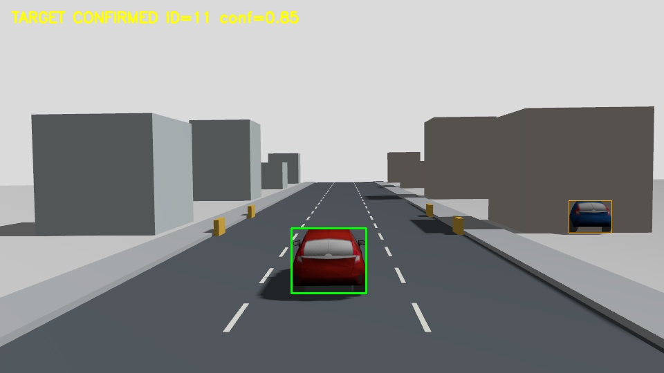
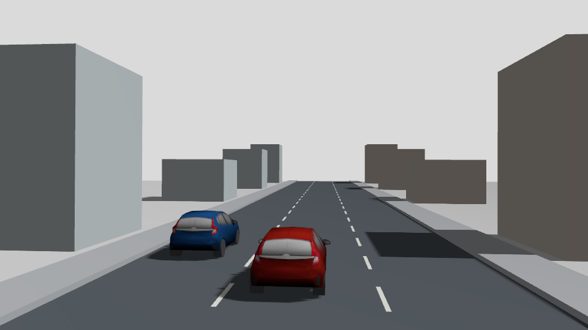
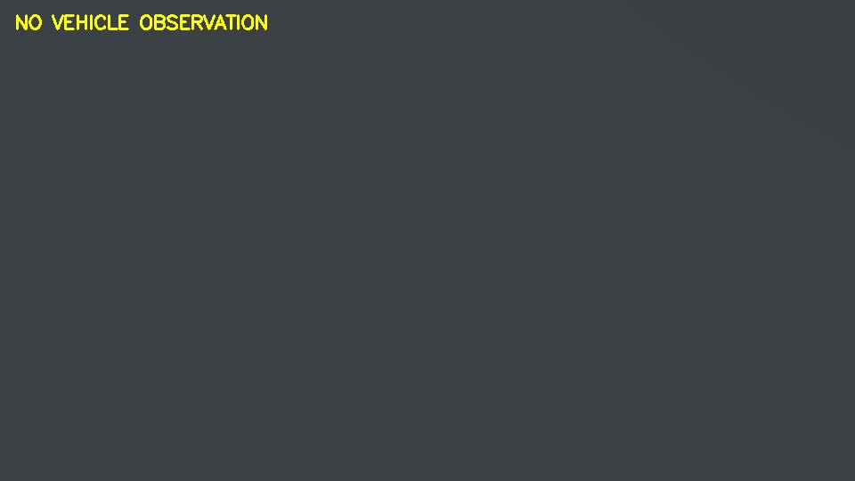

# ROS 2 无人机车辆跟踪项目 30 分钟介绍

适用场合：项目答辩、阶段汇报、技术交流。数据日期：2026-10-11。介绍对象为当前代码和最终完整十次异色分车道超车实验，不混入已删除的历史实验成绩。

本文包含可直接讲述的正文、时间分配和展示提示。正文以自然语速讲解，图像、架构图和结果表的解释计入对应时段；“展示提示”不朗读，末尾答疑不计入 30 分钟。实际时长需结合个人语速排练，不能只靠文件字数保证。

## 时间安排

| 时间 | 时长 | 内容 | 建议幻灯片 |
| --- | --- | --- | --- |
| 00:00 至 02:00 | 2 分钟 | 背景与项目目标 | 1 |
| 02:00 至 05:00 | 3 分钟 | 仿真场景与任务定义 | 2 至 3 |
| 05:00 至 09:00 | 4 分钟 | 技术栈与系统架构 | 4 至 5 |
| 09:00 至 14:00 | 5 分钟 | YOLO、ByteTrack 与原目标身份维护 | 6 至 8 |
| 14:00 至 19:00 | 5 分钟 | 飞行闭环、遮挡恢复与安全边界 | 9 至 10 |
| 19:00 至 23:00 | 4 分钟 | 主要困难和解决方法 | 11 至 12 |
| 23:00 至 28:00 | 5 分钟 | 实验协议、指标与最终结果 | 13 至 14 |
| 28:00 至 30:00 | 2 分钟 | 项目价值、局限与总结 | 15 |
| 合计 | 30 分钟 | 展示与讲述合计，答疑另计 | 15 页左右 |

## 一 背景与项目目标

时间：00:00 至 02:00。

【展示提示】标题页写“基于 ROS 2、YOLO 与 PX4 的无人机车辆跟踪仿真系统”。背景使用下方真实实验图，不使用与项目无关的无人机宣传图片。开场约 20 秒介绍题目，随后说明问题与目标。

### 讲述正文

大家好，今天介绍的是一个基于 ROS 2、PX4 和 Gazebo 的无人机车辆跟踪项目。这个项目研究的问题是：无人机仅依靠相机看到的图像，能否找到一辆指定车辆，随它持续向前运动，在目标被遮挡后重新确认原来的车辆，并最终自主返航和降落。

这里有一个重要区别：在图片里检测出车辆，并不等于已经完成车辆跟踪。车辆会移动，无人机也会移动，相机视角不断变化；道路上可能还有其他车辆；原目标还可能暂时完全看不见。因此，系统不仅要回答“图像里有没有车”，还要回答“是不是原来的那辆车”，以及“当前是否有足够可靠的观测来指导无人机继续运动”。

本项目把任务拆成三个相互联系的层次。第一层是感知，输出车辆检测和跨帧轨迹；第二层是身份维护，在遮挡或轨迹编号变化之后，判断是否重新找到原目标；第三层是飞行控制，根据确认目标调整无人机位置，并在失去可靠观测时执行有界恢复和安全处理。

最终要验证的也不是一张效果图，而是从起飞、搜索、跟随、遮挡恢复，到返航降落的完整任务。当前最终版本完成了十次独立重启实验，严格联合验收全部通过，平均原目标确认覆盖率为百分之九十点六九。但它仍然存在非计划丢失，所以今天既介绍已经实现的能力，也说明还没有解决的边界。

接下来，我先介绍场景和任务，再讲系统如何把检测、身份和飞行连成闭环，最后用重复实验结果说明项目的实际效果。

## 二 仿真场景与任务定义

时间：02:00 至 05:00。

【展示提示】先展示正常跟随图约 20 秒，再展示超车原图约 20 秒，分别指出原目标、其他车辆和道路。图像文件名中的时间是记录器时间，不是车辆运动起点。





### 讲述正文

目前保留的最终验证场景是一条较长的道路。道路宽度为十二米，纵向范围大约从负三十米延伸到二百五十米。这样设置的目的，是让车辆和无人机能够持续前进，避免道路太短时只能验证无人机原地转向，而不能验证真正的运动跟随。

场景中，红色车辆是原目标，蓝色车辆是干扰车。两辆车在不同车道内运动，蓝车从后方超越红车。第一张图展示无人机正常跟随红车，第二张原图展示超车过程。注意，最终场景采用不同颜色和分车道设置，是为了让身份任务定义更清楚，避免车辆实体重合；不能把这个结果直接当作同外观车辆交叉识别的成绩。

目标车的运动速度设置为每秒零点八米。车辆不是无人机起飞前就一直开走，而是在任务第一次进入 TRACK 后开始运动。这样既能验证持续跟随，也让道路遮挡事件相对于车辆运动起点保持明确的时间关系。

车辆开始运动十五个仿真秒之后，场景引入道路遮挡，持续四个仿真秒。在这段时间里，车没有停止，系统也不能读取车辆真值来继续跟踪。目标重新出现后，感知节点需要通过真实图像重新确认它，飞行控制器才重新进入可靠跟随。

这里要区分两个时钟。车辆运动和遮挡配置使用仿真时间；实验恢复耗时使用实际经过的墙钟时间。仿真运行速度受机器负载影响，四个仿真秒不一定等于四个实际秒，因此不能把遮挡时长和恢复耗时直接相加或比较。

还有一个工程边界：车辆运动通过 Gazebo 位姿服务更新。它适合构造可重复的视觉运动、遮挡和超车事件，但不是包含轮胎、转向和动力系统的真实车辆驾驶模型。无人机则由 PX4 SITL 控制，在 Gazebo 中完成飞行。

整个任务有明确的终点。无人机不能一直追到道路尽头，而是达到跟踪任务要求后，返回起飞区域，自动降落并解锁关闭。项目的名义飞行高度为三米，有效 TRACK 时长目标为九十秒。只有检测、身份、飞行流程和安全条件共同满足，才算完整通过。

下面介绍支撑这个场景的技术栈，以及各个模块之间如何传递数据。

## 三 技术栈与系统架构

时间：05:00 至 09:00。

【展示提示】用两页分别展示分层技术栈和闭环数据流。讲数据流时沿图逐项指出输入、输出和反馈方向，预留约 30 秒。评测支路画在控制支路之外。

| 层次 | 主要技术 | 负责内容 |
| --- | --- | --- |
| 机器人软件 | ROS 2 Jazzy、rclpy、DDS、Launch | 消息、节点、参数与启动 |
| 物理仿真 | Gazebo Harmonic、SDF、X500 相机 | 场景、图像与无人机运动 |
| 飞控 | PX4 SITL、EKF2、Offboard | 状态估计、飞行控制与模式执行 |
| 桥接 | Micro XRCE-DDS Agent、px4_msgs、ros_gz_image | 飞控与相机数据接入 |
| 视觉感知 | YOLO11s、PyTorch、ByteTrack、OpenCV | 检测、轨迹和相机运动补偿 |
| 任务与评测 | 自定义控制器、目标锁、pytest、pyulog | 身份、任务、安全与实验审计 |

```text
Gazebo RGB 相机
    |
    v
ros_gz_image -> /camera/image_raw
    |
    v
perception_node
    最新帧 -> YOLO -> 可选 ROI 检测合并 -> ByteTrack
    相机运动补偿 -> 轨迹与原目标预测
    VehicleTargetLock -> 原目标确认 + 候选诊断
    |
    v
/perception/target -> px4_offboard_controller
    |
    v
/fmu/in/* -> Micro XRCE-DDS -> PX4 -> 无人机运动
    ^                                      |
    |                                      v
/fmu/out/* <--------- 无人机状态反馈      新的相机图像

独立评测支路：Gazebo 车辆真值 + 图像时间戳 -> 身份评分
记录与监督：图像、消息、事件、ULog、重启和安全清理
```

### 讲述正文

项目的软件平台是 ROS 2 Jazzy。ROS 2 在这里承担的是模块之间的通信、参数管理和启动组织。图像、目标检测、任务状态和飞控消息通过节点和 Topic 传递，Python 节点主要使用 rclpy 开发，工作区使用 colcon 构建。

仿真平台是 Gazebo Harmonic。它提供道路、车辆、建筑物、遮挡物和带 RGB 相机的 X500 无人机。飞控采用 PX4 SITL，也就是软件在环。PX4 负责无人机状态估计和底层飞行控制，项目自己的 ROS 控制器负责生成任务相关的位置、速度和航向设定点，不直接控制电机。

ROS 与 PX4 之间通过 Micro XRCE-DDS Agent 和 px4_msgs 连接。控制器把设定点和指令发往飞控输入接口，从飞控输出接口接收状态、位置、着陆信息和指令回执。这些反馈不仅用于控制，还用于判断是否完成返航降落，以及是否出现安全异常。

视觉链路从 Gazebo 相机开始。相机图像经过 ros_gz_image 进入 ROS，感知节点用 cv_bridge 转换图像，然后执行 YOLO 检测。当前模型是 YOLO11s，使用 PyTorch 的 CPU 推理。检测结果经过可选的局部 ROI 检测合并后，交给 ByteTrack 更新跨帧轨迹，再由原目标锁判断哪些观测可以确认原来的车辆。

YOLO 和 ByteTrack 在同一个感知节点里运行。它们之间传的是内存中的检测框、类别和置信度，不是先把每个框发出去，再从另一个 ROS 节点读回来。因此，这里的检测与跟踪是两个算法阶段，但不需要两套独立的跨节点通信。

感知节点对外发布两类重要信息。一类是当前检测到的车辆候选，另一类是已经确认的原目标。控制器主要依据后者进行任务运动，候选和拒绝原因则为实验诊断服务。这个区分使“图像里有车”和“系统确认原车”不再被混成同一个状态。

OpenCV 并没有完全退出项目。我们用 YOLO 替换传统车辆检测方法，但图像转换、HSV 外观特征、稀疏光流、相机运动补偿和局部图像处理仍然需要 OpenCV。更准确的说法是替换了检测器，而不是替换整个图像处理技术栈。

最后，系统还有两条不能忽视的支路。记录器保存图像、候选、控制状态和任务事件；监督器负责独立重启、实际参数检查，以及异常后的安全清理。独立评测程序可以读取车辆真值，但它不把真值送给感知或控制。否则，无人机实际上是在按真值追车，不能证明视觉跟踪能力。

因此，这个架构的关键不是工具数量多，而是各层职责清楚：仿真产生观测，感知解释观测，身份模块确认目标，任务模块决定动作，PX4 执行动作，新的图像再反馈回来。

## 四 YOLO ByteTrack 与原目标身份维护

时间：09:00 至 14:00。

【展示提示】三页分别展示检测与跟踪的分工、原目标锁的证据、相机运动补偿与 ROI。可用“遮挡前 ID 为 A，遮挡后 ID 为 B”的示意解释身份与编号的区别；A、B 是教学示例，不冒充实际试次 ID。

### 讲述正文

接下来介绍感知内部的工作方式，首先回答一个常见问题：已经用了 YOLO，为什么还要 ByteTrack？

YOLO 的主要任务是检测。对于当前图像，它给出哪些区域是车辆、框在哪里、类别是什么，以及置信度是多少。但是，仅有检测框并不能天然说明这一帧的红车和上一帧的红车是同一个对象。尤其多辆车同时出现时，检测框顺序和数量都会变化。

ByteTrack 提供的是跨帧数据关联。它根据已有轨迹预测下一帧的位置，再把新的检测匹配到历史轨迹上，并分配短期轨迹 ID。它还利用高分与低分检测进行分阶段关联，使一些分数暂时下降的车辆仍有机会维持原轨迹。因此，它依赖检测观测，不是不用检测就能无限跟踪的独立识别器。

两者的配合可以这样理解：YOLO 每次提供当前看到了什么，ByteTrack 根据过去的运动关系判断这些检测可能属于哪条轨迹。如果这一帧检测为空，跟踪器可以暂时保留或预测历史状态，但预测本身不能证明车辆此刻真实可见，也不能保证长遮挡后的身份。

因此，本项目在 ByteTrack 之外还有一个 VehicleTargetLock，也就是原目标锁。这个模块维护的是“任务最初选中的那辆车”，不是某一个永不变化的数字编号。假设遮挡前车辆的 ID 是 A，遮挡后检测重新建立了 ID B，只要新的观测符合原目标证据，系统可以在新 ID 下恢复原车。反过来，即使数字 ID 没变，也不能无条件认为身份一定正确。

目标锁使用多种证据。第一是中心预测，判断候选是否出现在合理位置；第二是框尺度，判断宽度和高度变化是否符合连续运动；第三是 HSV 外观特征，比较颜色分布；还包括预测不确定性、检测置信度和轨迹连续性。它不是把这些因素中的任意一个单独作为身份证明，而是一起限制关联。

这里的 HSV 特征是传统外观描述，不是训练出来的 ReID 网络。对于颜色不同的车辆，它能提供有用信息；对于完全相同外观、相近运动的车辆，它的区分能力就有限。这个限制也是最终异色超车结果不能直接推广到同外观交叉的原因。

低置信度检测需要特别处理。如果所有低分框都被删除，短时变小或部分遮挡的车辆容易断轨；如果全部接受，又容易把误检或其他车接进原目标。所以，低分无 ID 候选需要连续多帧证据和近期强观测支持。缺帧、拒绝和歧义会打断确认序列，弱观测也不能无限延续强观测的可信时间。

另一个关键环节是相机运动补偿。普通图像轨迹预测看到的是图像坐标变化，但在无人机场景中，车辆图像位移包含车辆自身运动和相机运动。无人机转向或俯仰时，即使车速没有突变，画面里的框也可能大幅移动。

项目通过背景稀疏光流和注册估计视角变化，把上一帧的预测变换到当前视角。这里需要屏蔽车辆等前景，检查有效特征数量和变换合理性，并对 ByteTrack 的中心、长宽比、高度及速度状态分别适配。补偿同时作用于短期轨迹和原目标预测，避免两套预测使用不同坐标。

但补偿只是减少相机运动带来的误差，不是精确三维重建。背景深度不同、局部透视明显或图像特征不足时，补偿仍会有残差。质量不合格时不能强行使用，也不能因为补偿成功就刷新原目标身份。

在全图检测没有找到足够可靠的目标证据时，系统还可以按预测位置增加一次有界 ROI 放大检测。ROI 就是图像中的局部区域，放大后有时能帮助检测较小目标。这里不会使用车辆真值定位 ROI，也不会把预测框直接当作检测。ROI 得到的框仍需通过 ByteTrack 和身份门控，计算预算不足时则跳过额外推理。

最后，实际处理使用最新帧策略。相机可能产生很多图像，但 CPU 推理速度有限；系统不会为了逐张处理而积压旧画面，而是优先处理较新的输入。每张实际处理图像仍执行检测与跟踪更新，但不意味着每一张相机原始帧都参加计算。

概括起来，这条链路依次回答三个问题：YOLO 回答有没有车，ByteTrack 回答短期轨迹如何连接，原目标锁回答是不是任务原来的车。把这三个问题分开，是遮挡恢复和错车诊断的基础。

## 五 飞行闭环与遮挡恢复

时间：14:00 至 19:00。

【展示提示】展示任务状态图，再展示下面的遮挡记录，说明完全遮挡时没有车辆观测。预留约 20 秒指认图像。返回正常跟随图时强调“恢复需要真实确认”，不要仅以状态文字代替身份评测。

```text
等待飞控 -> Offboard 预发送 -> 切换模式 -> 解锁 -> 起飞 -> 悬停
    -> SEARCH -> DETECT -> APPROACH -> TRACK
                                           |
                                确认观测持续缺失
                                           v
                                        RECOVER
                           真实确认恢复 / 预算耗尽
                               TRACK      SEARCH

跟踪任务完成 -> RETURN -> LAND -> 落地解锁 -> DONE
异常 -> 监督器停止 Offboard 发布 -> 请求降落 -> 等待落地解锁
```



### 讲述正文

有了可信的目标观测，下一步是让无人机真正运动起来。项目通过任务状态机组织完整流程，而不是一启动就持续发送追车速度。

任务首先等待 PX4 状态就绪，预先发送 Offboard 所需的控制流，再请求切换模式与解锁。随后起飞到设定高度并悬停，进入搜索阶段。搜索中找到候选后，还要经历检测确认和接近，再进入 TRACK。这个过程让初始目标选择和稳定跟随之间有明确的过渡。

在 TRACK 中，控制器使用图像反馈调整运动。目标偏离水平参考位置时，系统产生航向或横向修正；目标框大小变化则作为接近程度的近似反馈，同时考虑垂直构图。位置设定点的领先距离和变化受到限制，避免观测误差一下子变成过大的飞行动作。

这里不能把框面积当作精确距离。车辆外形、相机视角、俯仰和截断都会改变框面积。本项目实现的是基于图像反馈的跟随，并没有证明通过一个框就能精确恢复车辆的米制三维位置。

闭环的含义是，无人机动作会改变下一帧图像，而下一帧又影响新的动作。如果控制过急，车可能冲到画面边缘；如果制动产生俯仰变化，车的垂直位置和尺度也会变化。感知与控制不是两个互不影响的独立程序，必须一起观察。

面对短暂漏检，系统首先做零点五秒去抖，避免一帧负观测就立刻退出 TRACK。但去抖不代表那段时间已经确认了目标，它只是防止任务状态过度抖动。如果缺口继续增长，系统进入 RECOVER，在满足相机持续更新和导航有效的前提下，执行有限的预测运动。

这时最重要的安全边界是十秒盲跟限制。所谓盲跟，是当前没有可靠原目标确认，却仍根据历史运动趋势继续移动。系统允许这种恢复，但墙钟时间最多十秒，恢复位移最多四米，恢复预测速度上限为每秒零点八米。任何预测都不能被写成真实观测，也不能把盲跟预算刷新。

这个限制的目的，是约束无人机运动，不是约束它以后还能不能重新看见原车。预算耗尽时，控制器不能继续无边界追随，但视觉重关联仍然开放。如果原车后来回到图像中，并通过身份和连续观测条件，任务仍可恢复。否则，“超过十秒”就会变成永久关联锁死，与恢复目标的设计相矛盾。

这张遮挡图展示了另一种情况：当前画面已经被遮挡物覆盖，没有可用车辆观测。此时让检测器持续输出一个框，并不能增加真实信息。正确行为是承认观测缺失，保留有界预测和安全控制，等遮挡结束后再用新的视觉证据确认。

遮挡恢复也不是看到任何车辆就马上加速。干扰车可能恰好靠近预测位置，所以恢复首先要过原目标身份条件，必要时等待多帧。短期恢复速度与错车风险之间存在取舍，项目没有通过统一放宽所有门限来追求更高覆盖率。

完成有效跟踪目标后，无人机进入 RETURN，回到起飞区域，然后 LAND，最终确认落地与解锁。只进入 RETURN 或听到飞控提示，并不能代表安全任务完成，记录器还要检查状态和飞控日志。

如果发生异常，监督器先停止原任务的 Offboard 发布，再向 PX4 请求降落，等待安全落地和解锁后清理进程。这是为了避免任务控制与安全降落同时争夺控制权。如果这一过程需要监督接管，即使最终落地，也不能记为自主成功。

因此，恢复策略的原则是：短缺口不放大成长故障，长缺口不演变成无限盲跟，重新确认不因超时永久关闭，任务成功不以掩盖安全接管为代价。

## 六 主要困难与解决方法

时间：19:00 至 23:00。

【展示提示】用两页展示四组“现象、原因、处理、边界”。这里讲工程方法，不展示已删除的历史失败目录，也不声称每项改动都有同条件收益对照。

### 讲述正文

项目过程中最主要的困难不是单个算法无法运行，而是模块连接之后出现了新的问题。我用四组例子说明。

第一组是“车就在图像里，但系统说丢失”。最初容易把这种现象全部归因于 YOLO 漏检。后来把车辆候选和原目标确认拆开，记录每个候选的拒绝原因，才发现有些帧已经检测到原车，但中心、尺度、外观或连续确认条件没有通过。

所以，处理方法不是简单把检测阈值调低，而是先识别拒绝发生在哪个阶段。对于真正没有检测的帧，考虑检测能力；对于已经有正确候选的帧，检查运动预测、观测时序和身份确认。这样才能避免为了提高覆盖率，反而把干扰车接进原目标。

第二组是截断框污染几何预测。车辆靠近图像下边缘时，看到的只有一部分车身。如果直接把这部分框高度当作完整高度，滤波器会认为车身快速缩小，还可能学习到错误的高度速度。等原车重新出现，它反而不符合系统自己的尺度预测。

当前处理是区分完整观测和垂直截断观测。接受部分框时，只校正水平中心和宽度，不直接更新完整垂直中心与车身高度，并清零对应速度。初次锁定也不使用这种不完整框。这样可以避免把“看不全”误学成“车变小了”。但这不是图像补全方法，也没有解决所有内部遮挡。

第三组是延迟和相机姿态的共同影响。CPU 推理与仿真渲染共享资源，处理变慢时，旧画面如果在队列里越积越多，就会让无人机按过去的位置控制。制动和俯仰又改变垂直构图，进一步影响框中心和尺度。

项目采用最新帧缓冲、过期结果保护和相机运动补偿，并记录处理耗时、观测年龄及关联间隔。这里的工程判断是，减少积压有价值，但不能把它说成已经达到硬实时。最终实验仍有时延波动，说明闭环不仅要看平均推理速度，还要看不规则观测间隔。

第四组是场景服务可靠性。车辆位姿更新和场景创建通过 Gazebo 请求完成。如果请求失败，车辆可能没有按计划移动，超车或遮挡事件也可能没有正确发生。此时即使无人机完成了飞行流程，严格联合验收也不能算通过。

最终方案复用持久的原生通信连接，并把阻塞请求放到独立服务子进程，避免它与订阅回调竞争。每个请求记录序号、原生回执、成功标志和耗时，不把超时伪装成成功，也不靠无限重试掩盖问题。最终十次实验共八千一百四十九次请求，全部成功，说明这个场景执行问题在本批得到了重复验证。

这些处理背后有共同思路：先把问题分层，再保护观测与预测的语义，最后用记录验证。检测失败、身份拒绝、消息过期、控制抖动和场景执行错误需要分别分析，不能用一个“目标丢失”标签概括所有原因。

同时，解决工程问题不代表所有跟踪困难都消失。最终第六、九次仍出现较长恢复，但场景请求为零失败，所以剩余恢复问题不能继续归因于场景服务。下面用完整实验结果说明当前能力和不足。

## 七 实验协议与最终结果

时间：23:00 至 28:00。

【展示提示】第一页解释实验协议和覆盖率口径；第二页展示批量图表，重点指出第 06、09 次。统计表用于备查，不逐格朗读。图表指认与结果解释预留约 45 秒。

### 讲述正文

为了避免只挑选一次顺利演示，最终实验采用固定版本重复验证。代码、模型权重、实际 ROS 参数和启动条件一起冻结，记录了五百三十四个文件。最终使用 YOLO11s、Torch CPU、ByteTrack、GMC、ROI、截断滤波保护和尺度速度预测；候选竞争恢复与实验性控制平滑关闭。

每一次都重新启动完整飞行与仿真进程，不是在一个已经运行的场景里简单重置车辆位置。计划十次，实际启动十次，没有补选、替换或未启动试次。所有结果都进入统计，原来的选择参考不进入十次分母。

成功分为三层。任务通过要求完整跟踪、返航、落地解锁，并满足确认覆盖率、运动和安全等条件；身份通过由独立评测检查原目标和场景事件；严格联合通过要求二者都通过。因此，“能飞完”不是“严格通过”，“画面里有框”也不是“身份通过”。

主要效果指标叫原目标确认覆盖率。它的分母是第一次进入 TRACK 之后的跟随窗口，包含 TRACK、RECOVER，以及恢复中的 SEARCH、DETECT 和 APPROACH。分子是在这个窗口内，符合记录器新鲜度规则的原目标确认时长。起飞前的等待不算跟随损失，但跟随开始后的重新搜索不能从分母里删掉。

举一个教学例子：如果跟随窗口是一百秒，有九十秒能按这个规则确认原目标，覆盖率就是百分之九十。这只是帮助理解公式的例子，不是本批某一次的实际时长。覆盖率反映检测、关联、恢复和消息时序的综合效果，不等于 YOLO 的 mAP，也不是逐像素判断车身可见的比例。

最终十次任务、独立身份和严格联合全部通过。确认覆盖率均值是百分之九十点六九，样本标准差为二点三九个百分点，最差结果为百分之八十六点零五。第六次和第九次明显低于其余试次，但仍满足既定验收线，而且这两次并没有被删除。

道路预设遮挡结束后的确认恢复，平均需要一点六五四个墙钟秒，最差一点八八一个墙钟秒。非计划丢失共有七个事件，事件级平均恢复为二点一五八秒，最长为六点七零秒。没有发生非计划丢失的试次，不把不存在的恢复时间补成零来拉低平均值。

这说明十次全部通过，不代表全程连续无丢失。整个批次共有十七次 TRACK 丢失，其中十次属于预设道路遮挡，七次属于非计划丢失，最终都恢复。任务成功和瞬时连续性是两个不同指标，需要同时报告。

跟随运动方面，无人机在跟随窗口内的行进距离平均为五十一点七三米，最短也有四十八点零三米。这支持项目验证的是持续运动跟随，不只是定点拍摄。平均横向像素误差跨试次均值为十六点零七像素；这个误差只针对确认观测，不能推断丢失期间仍保持同样精度。

实时性方面，各次平均感知处理耗时的均值为一百七十九点九零毫秒，单帧处理峰值最差达到三百九十点零六毫秒。这些数字不是完整曝光到控制执行时延，也不能直接把平均耗时的倒数当成整个系统帧率。它们说明 CPU 方案能完成当前闭环，但仍存在处理波动。

身份和安全方面，没有可评分错车或身份切换，没有监督接管，飞控日志没有记录到 armed failsafe、armed Offboard 信号丢失或 ULog dropout。场景请求八千一百四十九次全部成功。这里使用“可评分”和“记录到的”这样的限定，是因为有限记录和有限场景不能证明所有情况下都不会出问题。

最后看最差结果。第六次有约六点二零秒长恢复，第九次约六点七零秒。在这些区间，独立投影能匹配原车的候选中仍有中心门控拒绝和等待确认，邻域关联记录间隔约达到一点二秒。因此，后续若继续研究，应优先关注中心预测和完整观测时序，而不是直接宣布 YOLO 完全没有检测，也不是继续统一放宽门限。

另外，虽然 ROS 配置冻结，PX4 自动校准与累计状态没有强制清空，部分试次的气压计初值不同。历史实验原始产物也已按要求清理。因此，本次结论限定为最终固定场景的十次重复，不与旧场景混算，也不声称整个开发过程从未失败。

### 展示用公式

```text
原目标确认覆盖率
  = 跟随窗口内有效原目标确认时长 / 跟随窗口总时长 x 100%

跟随窗口：首次 TRACK 后的 TRACK / RECOVER / SEARCH / DETECT / APPROACH
新鲜度规则：已确认目标消息的时间积分最多延续到其接收后 0.5 秒
注意：这是记录器的确认指标，不是每一时刻像素可见性的真实积分。

严格联合通过 = 任务验收通过 AND 独立身份验收通过
```


### 展示用逐次表

| 试次 | 确认覆盖率 | 非计划丢失次数 | 道路遮挡确认恢复 s | 严格联合 |
| --- | --- | --- | --- | --- |
| 01 | 92.35% | 1 | 1.652 | 通过 |
| 02 | 92.27% | 1 | 1.142 | 通过 |
| 03 | 91.64% | 0 | 1.785 | 通过 |
| 04 | 92.23% | 0 | 1.528 | 通过 |
| 05 | 91.33% | 1 | 1.881 | 通过 |
| 06 | 86.41% | 2 | 1.867 | 通过 |
| 07 | 91.97% | 0 | 1.522 | 通过 |
| 08 | 91.24% | 1 | 1.840 | 通过 |
| 09 | 86.05% | 1 | 1.660 | 通过 |
| 10 | 91.45% | 0 | 1.662 | 通过 |

### 展示用核心统计

| 指标 | 样本口径 | 均值 | 样本标准差 | 最差 |
| --- | --- | --- | --- | --- |
| 原目标确认覆盖率 | 10 次 | 90.69% | 2.39 个百分点 | 86.05% |
| 非计划丢失次数 | 10 次 | 0.70 | 0.67 | 2 |
| 道路遮挡确认恢复 | 10 次 | 1.654 s | 0.222 s | 1.881 s |
| 非计划恢复 | 7 个事件 | 2.158 s | 2.941 s | 6.700 s |
| 平均横向像素误差 | 10 次 | 16.07 px | 5.86 px | 22.13 px |
| 平均感知处理耗时 | 10 次 | 179.90 ms | 16.22 ms | 195.71 ms |
| 无人机跟随行进距离 | 10 次 | 51.73 m | 3.29 m | 最短 48.03 m |

除事件级恢复外，统计先在每个试次内计算，再跨十次汇总，不是把所有帧合并统计。完整指标、P95、输入哈希与安全核验见[最终报告](results/vehicle_tracking_validation/scene_transport_isolated_repeat_audit_20261011_01/FINAL_REPORT.md)。

## 八 项目价值与总结

时间：28:00 至 30:00。

【展示提示】最后一页列出“完整闭环、身份与轨迹分离、有界恢复、重复验证”四点，底部保留“仅仿真、仅当前场景、仍有丢失”的边界。约 20 秒收束，不在此处启动新实验。

### 讲述正文

最后总结一下，这个项目的价值可以分为四点。

第一，它把车辆检测延伸成了完整飞行任务。无人机不仅在图像上画框，还要实际向前跟随，处理遮挡，最后自主返航和降落。最终五十多米的平均跟随行进距离和完整任务记录，为这种闭环提供了证据。

第二，它区分了短期轨迹和原目标身份。ByteTrack 尽量保持轨迹连续，目标锁维护原车语义，检测与确认分别发布。这让系统不再把同一个数字编号误认为永久身份，也让“车看得见却没确认”的问题能够被具体分析。

第三，它把恢复能力和安全限制放在一起设计。短漏检有去抖，遮挡后有有界预测，但十秒盲跟、四米位移等限制仍然保留；停止盲跟不等于永久停止视觉恢复。系统既不能盲目追，也不能因为一次超时永远不再认识原车。

第四，它形成了可以解释的重复验证方式。固定版本、独立重启、保留全部试次，通过原始图像、候选原因、场景回执和飞控日志，把任务、身份和安全放在同一个验收框架里，而不是只展示一段顺利视频。

目前的结论是，项目在最终异色分车道超车和运动遮挡场景中，完成了十次严格联合通过，平均确认覆盖率百分之九十点六九，具备当前场景下可重复的完整仿真跟踪能力。

仍然没有解决的部分包括时延波动、偶发长恢复、同外观车辆的强身份歧义，以及更复杂环境的泛化。没有实机飞行，也没有硬实时或学习型 ReID 的验证。若未来进入下一阶段，应在新的独立实验中验证这些能力，而不是改写当前批次或把仿真成绩直接当作部署可靠性。

我的介绍到这里。谢谢大家，下面可以围绕感知分工、身份恢复、安全策略或实验指标展开讨论。

## 备用答疑

以下不计入 30 分钟正文，按现场问题选择使用。

### 1 只用 YOLO 能不能完成任务

YOLO 可以提供单帧车辆检测，简单单车场景也可以直接使用检测框控制。但它没有天然提供跨帧身份关系；ByteTrack 提供短期预测和关联，原目标锁进一步处理任务身份。去掉它们会改变系统能力，需要单独对照，不能仅凭“能检测到车”判断等价。

### 2 YOLO 和 ByteTrack 是否分成两个部署节点

当前二者在同一个感知节点中，通过内存中的检测框、类别和分数配合。整个感知节点与控制节点通过 ROS 消息通信；实机部署时是否进一步拆分取决于计算资源和通信预算，不是本项目已经验证的部署结果。

### 3 ID 改变是不是一定跟错车

不是。ID 是短期轨迹标签，遮挡后新 ID 可能仍对应原车。系统需要通过原目标锁和独立身份评测判断。反过来，ID 没变也不能保证没发生错配。

### 4 画面有车辆为什么仍会丢失

可能没有有效检测，也可能有候选但身份门控拒绝、仍在多帧确认，或消息过期、控制器还没恢复。应检查候选诊断和时间戳。最终长恢复中存在匹配原车却被中心门控拒绝的候选，不能全部称为 YOLO 漏检。

### 5 为什么保留十秒盲跟限制

没有可靠观测时，预测误差随时间增长。十秒限制约束恢复运动，配合四米位移与恢复速度上限。它不关闭后续视觉重关联，真实身份确认回来后仍可恢复。

### 6 遮挡四秒为何恢复平均一点六五四秒

四秒是遮挡持续的仿真时间；一点六五四秒是遮挡结束之后，到确认恢复的墙钟耗时。两者起点、时钟和统计含义不同，不存在相互矛盾。

### 7 是否靠 Gazebo 真值来控制无人机

不是。车辆真值只进入独立评测与记录支路。控制使用图像目标观测及无人机自身状态；用真值追车会改变任务性质，不能用来证明视觉跟踪效果。

### 8 最终十次通过是否代表准确率百分之百

不代表。10/10 是这十次固定场景的严格联合成功率，不是检测 mAP，也不是所有环境成功率。确认覆盖率为 90.69%，仍有七次非计划丢失。异色超车成绩不能替代同外观交叉或实机验证。

### 9 项目有没有训练新模型或提出新的跟踪算法

没有新 YOLO 训练成果，也没有把 ByteTrack 当成自行提出的算法。主要工作是系统集成、原目标维护、相机运动补偿适配、截断观测保护、有界恢复和可审计的闭环验证。

### 10 清理旧失败案例会不会影响最终统计

最终批次十次全部保留，包含低覆盖率和全部丢失记录，分母没有变化。被删除的是早期其他版本或场景的产物，因此目前不能重新核验历史失败，更不能声称整个开发过程零失败。

## 材料与证据索引

- [项目总览](PROJECT_OVERVIEW.md)：架构、配置、代码索引与结论边界。
- [主要困难](PROJECT_CHALLENGES.md)：现象、处理与剩余问题。
- [最终报告](results/vehicle_tracking_validation/scene_transport_isolated_repeat_audit_20261011_01/FINAL_REPORT.md)：逐次表、统计、图表与局限。
- [完整指标](results/vehicle_tracking_validation/scene_transport_isolated_repeat_audit_20261011_01/final_metrics.json)：指标数值、样本口径与输入证据。
- [原始实验](results/vehicle_tracking_validation/scene_transport_isolated_repeat_20261011_01/)：十次图像、参数、候选、任务与 ULog。
- [结果入口](results/vehicle_tracking_validation/README.md)：保留范围与清理说明。

演示时使用已有图像或另行录制的新批次视频，不覆盖最终证据；静态图不能替代时间连续性验证。不把本讲稿中的教学示例、未来方向或未启用功能写成最终实验成果。
