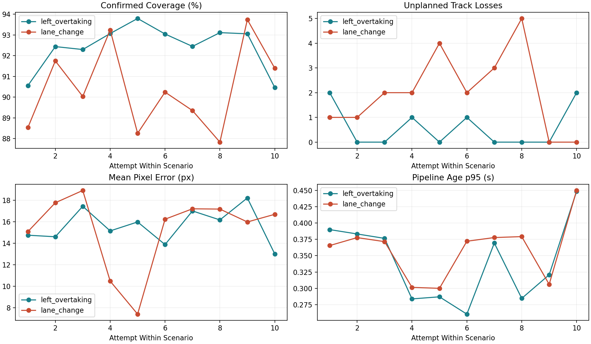

# ROS 2 PX4 Gazebo 无人机车辆跟踪

基于 ROS 2 Jazzy、PX4 SITL、Gazebo Harmonic、YOLO11s 和 ByteTrack 的车辆视觉跟踪仿真项目。实现自主起飞、搜索和确认原目标、持续跟随、遮挡恢复、返航、降落与独立实验评测，支持 Torch CPU 与 OpenVINO CPU FP32 检测后端。

车辆真值仅用于独立评测，不输入感知或飞行控制。当前成果限定于仿真，不包含实机部署、学习型 ReID、SLAM 或新 YOLO 模型训练。

## 当前验证概览

整理日期：2026-10-12。当前保留 Torch、OpenVINO 两个批次，各自两种同外观场景各十次，共四十次批量飞行。两批分别统计；OpenVINO 单次准入、GUI 开发参考和历史异色十次均不加入这四个分组的分母。默认后端仍为 Torch，OpenVINO 已完成仿真 CPU 后端接入与独立闭环验证，不代表实机部署完成。

### Torch 基线

当前版本新增逐候选重叠判别、观测空档后的有界尺度预测，以及重叠状态切换时的确认连续性。保留三帧确认和 10 秒盲跟限制，没有统一放宽关联门限。

Torch 基线批次两种同外观红车场景各完成 10 次无 GUI 独立重启，交替运行、未调参、未补跑替换失败：

| 指标 | 左侧车道超车 | 后侧变道超车再回中 |
| --- | ---: | ---: |
| 任务通过 | 10/10 | 10/10 |
| 独立身份通过 | 10/10 | 9/10 |
| 严格联合通过 | **8/10** | **9/10** |
| 确认覆盖率，均值 ± 样本标准差 | **92.43% ± 1.10 个百分点** | **90.44% ± 2.05 个百分点** |
| 最差覆盖率 | 90.46% | 87.83% |
| 非计划丢失总数 / 最长恢复 | 6 次 / 0.600 s | 20 次 / 4.327 s |
| 平均横向像素误差，跨试次均值 | 15.62 px | 15.30 px |

20 次均自主返航降落，可评分错车、身份切换、监督接管和记录到的 armed 安全事件为 0；这不等于所有帧身份均可评分或实机安全保证。严格未通过的 3 次分别为首次建路请求超时、4 条启动回执缺失、变道第 10 次返航前未覆盖完整回中及后续身份窗口。最后一例车流在 RETURN 后才完成动作，不是已经回中却认不出原车。不能删掉这 3 次后宣布全通过。

详见[Torch 基线批次报告](results/vehicle_tracking_validation/two_scenario_frozen_repeat_20261011_01/FINAL_REPORT.md)和[失败分析](results/vehicle_tracking_validation/two_scenario_frozen_repeat_20261011_01/FAILURE_ANALYSIS.md)。确认覆盖率不是检测 mAP，也不是独立身份准确率。

此前同版本单次 GUI 验证确认覆盖率 91.75%，非计划丢失 1 次，回中后有 53 帧独立原车证据并通过严格联合验收；这是[单次参考](results/vehicle_tracking_validation/continuity_gui_20261011_01/RESULTS.md)，不等于重复成功率。历史异色 GUI 十次批次的覆盖率为 90.69% ± 2.39 个百分点，严格通过 10/10，单独保留，不与新批次混计。



## OpenVINO 补充验证

新增相同 YOLO11s 权重的 OpenVINO CPU FP32 对照，先完成离线数值一致性与单次严格准入，再独立重启两场景各十次。单次不计入批量分母，未替换失败试次，保留 10 秒盲跟限制；默认 Torch 配置没有改动。

| 指标 | 左侧超车 | 后方变道超车再回中 |
| --- | ---: | ---: |
| 任务 / 独立身份 / 严格通过 | 10/10 / 10/10 / **7/10** | 9/10 / 10/10 / **3/10** |
| 确认覆盖率，均值 ± 样本标准差 | **94.19% ± 0.25 个百分点** | **92.62% ± 1.99 个百分点** |
| 完整感知平均处理耗时 | 128.01 ms | 127.26 ms |
| 非计划丢失总数 / 最长恢复 | 2 次 / 0.200 s | 13 次 / 2.400 s |

相对此前 Torch 二十次批次，覆盖率分别增加 1.76、2.19 个百分点，完整感知平均处理耗时下降约 29%、31%；这属于先后运行的观察性对照，不是随机化因果消融。全部二十次安全落地，可评分错车、身份切换及记录到的安全事件为 0。严格未通过十次：七次首次创建请求未获确认、两次启动回执缺失、一次遮挡入口未满足连续三帧确认。身份通过不等于所有图像身份准确率 100%。

详见 [OpenVINO 结果、失败原因及 Torch 对照](results/vehicle_tracking_validation/openvino_two_scenario_repeat_20261011_01/RESULTS.md)；[复现命令](docs/vehicle_tracking.md#openvino-补充闭环验证)。两批均保留原始验收结论，根目录四份介绍及同名 PDF 已整合两批结果；不会覆盖历史日志或把严格未通过改判成功。

## 文档

- [项目总览](PROJECT_OVERVIEW.md) / [PDF](PROJECT_OVERVIEW.pdf)
- [主要困难与解决方法](PROJECT_CHALLENGES.md) / [PDF](PROJECT_CHALLENGES.pdf)
- [项目问题复盘报告：核心问题、集成问题与未解决项](PROJECT_ISSUE_REPORT.md) / [PDF](PROJECT_ISSUE_REPORT.pdf)
- [30 分钟零基础介绍与代码导读](PROJECT_PRESENTATION_30MIN.md) / [PDF](PROJECT_PRESENTATION_30MIN.pdf)
- [运行与验证说明](docs/vehicle_tracking.md)
- [环境准备与仓库资源](docs/reproduction.md)
- [Torch 基线批次两场景批量报告](results/vehicle_tracking_validation/two_scenario_frozen_repeat_20261011_01/FINAL_REPORT.md)
- [OpenVINO 补充报告与失败分析](results/vehicle_tracking_validation/openvino_two_scenario_repeat_20261011_01/RESULTS.md)
- [历史异色十次报告](results/vehicle_tracking_validation/scene_transport_isolated_repeat_audit_20261011_01/FINAL_REPORT.md)
- [原始结果与清理说明](results/vehicle_tracking_validation/README.md)

早期部分开发产物曾按要求清理，不能重新计算全开发阶段失败率；之后保留的重叠拒绝、长恢复、身份证据不足及修复对照都仍可查阅，不因后续通过而删除。

## 数据流

```text
Gazebo RGB -> ROS 图像桥接 -> YOLO 检测 -> ByteTrack
  -> VehicleTargetLock 原目标确认 -> 任务状态机
  -> PX4 Offboard -> 无人机运动 -> 新的 RGB 图像

相机运动补偿服务轨迹与身份预测，ROI 提供有界局部检测。
独立评测使用车辆真值；记录器和监督器保存身份、任务与安全证据。
```

YOLO 与 ByteTrack 在同一感知节点内传递检测框、类别和置信度。短期轨迹 ID 与原目标身份分开维护。失去确认时保留 10 墙钟秒、4 m 位移与 0.8 m/s 预测速度的恢复限制；预算耗尽不永久禁止视觉重关联。

## 下载与运行

仓库包含原始实验数据，因此下载量较大。PX4、px4_msgs 和 DDS Agent 使用固定提交的 Git 子模块；虚拟环境与普通构建安装文件不上传，需要本机重新准备。

```bash
git clone --recurse-submodules https://github.com/0YJH0/uav-ros-px4-gazebo.git
cd uav-ros-px4-gazebo
```

先按 [环境准备](docs/reproduction.md) 安装依赖、恢复自定义相机模型并构建。准备完成后，在仓库根目录执行一次新的 GUI 闭环验证：

```bash
.venv-yolo/bin/python scripts/run_vehicle_tracking_validation.py \
  --output results/vehicle_tracking_validation/new_gui_validation \
  --gui --gui-config scripts/vehicle_tracking_gui.config \
  --overtaking --distractor-color red --parked-y -4.4 --vehicle-speed 0.8 \
  --occlusion-start 15 --occlusion-duration 4 \
  --model-path yolo11s.pt --detector-backend torch
```

输出必须使用新路径，不覆盖已归档数据。不在真实飞行器上直接运行仿真参数。

后侧同车道变道、左侧超车再回中场景：将上面的 `--overtaking` 改为 `--lane-change-overtaking`，并更换输出目录。批量实验采用无 GUI 独立重启，GUI 命令用于观察，不把不同运行负载当成严格消融。

复现当前两场景各 10 次的冻结批量协议：

```bash
.venv-yolo/bin/python scripts/repeat_two_vehicle_scenarios.py \
  --reference results/vehicle_tracking_validation/continuity_gui_20261011_01 \
  --output results/vehicle_tracking_validation/new_two_scenario_repeat \
  --count 10
```

默认两场景交替、无 GUI。可先加 `--prepare-only` 仅预检并冻结，再用相同命令加 `--resume` 启动；恢复只执行尚未尝试的试次，不替换失败。执行前须保持参考版本要求的代码、模型及构建一致，并确保没有其他仿真占用。

## 仓库内容

- `ros2_ws/src/uav_learning/`：感知、跟踪、目标锁、控制器、场景、测试与车辆模型。
- `ros2_ws/src/uav_interfaces/`：自定义目标与车辆观测消息及任务接口。
- `scripts/`：独立重启监督、批量编排、指标分析及离线工具。
- `config/gazebo_models/`：自定义 RGB 相机与 X500 模型的发布副本。
- `results/vehicle_tracking_validation/`：分场景重复实验、历史对照及独立审计，含原图、日志、ULog 和冻结快照。
- `yolo11s.pt`：选定检测模型；另有冻结副本供证据核验。

## 许可与复现边界

第三方组件保留各自许可证；本仓库不对其重新授权。PX4、DDS Agent、px4_msgs、Ultralytics 和模型权重的使用、修改与分发需遵守对应许可。车辆模型来源与 CC0 声明保存在各模型目录中。

冻结快照中的 PX4 可执行文件是实验溯源证据，不是通用安装包；新机器应从固定子模块源码重新编译。原日志中的绝对路径、参数和校准值保持原样，不能宣称在另一台机器上能够逐位复现。当前批次未强制清空 PX4 持久校准状态。
