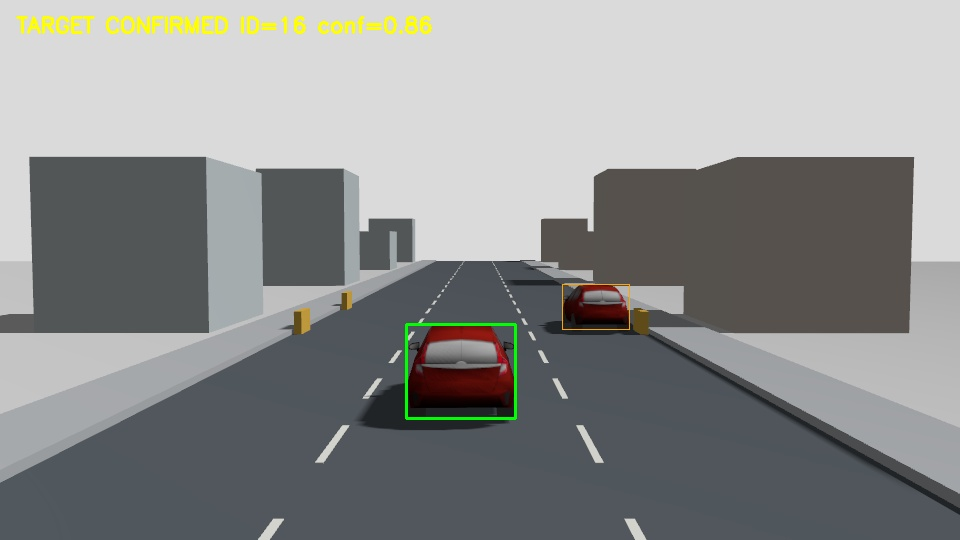
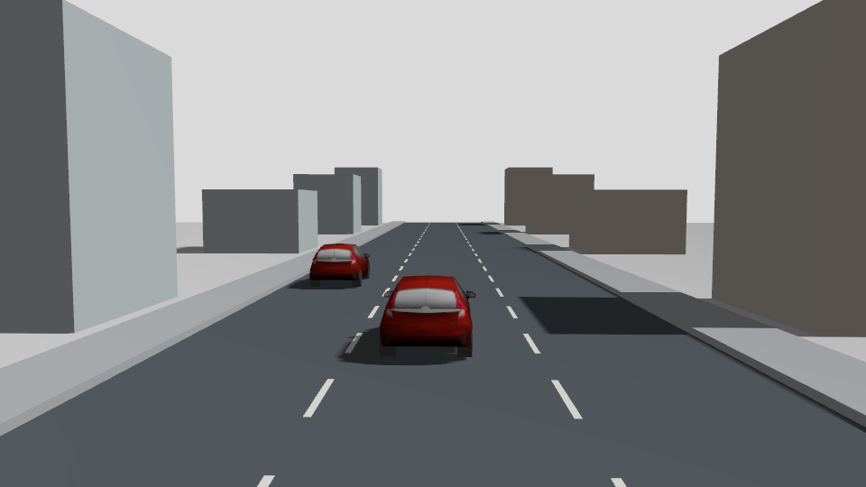

# 红色干扰车与路边停放车可视化验证

日期：2026-10-11。一次独立启动的 Gazebo GUI + PX4 SITL + ROS 2 闭环测试。

## 场景改动

- 动态超车干扰车与路边停放车均使用现有红色目标车模型，外观和目标相同。
- 停放车中心由 `(30, -12, 0.05)` 移至 `(30, -4.4, 0.05)` 米，实际 Gazebo 位姿已核验。
- 停放车车身距右侧路沿约 0.53 米，距附近护栏超过 0.20 米，不与目标车行驶范围重合。
- 保持 0.8 m/s 目标车速、分车道超车、运动开始后第 15 仿真秒起持续 4 仿真秒的遮挡。
- 检测模型、身份关联门限、控制算法和 10 墙钟秒盲跟限制未改；本次只增加场景配置及对应记录、测试。

颜色和停放位置同时变化，因此不是颜色单变量对照，也不纳入历史蓝色干扰车十次基线。

## 结果

| 指标 | 本次结果 |
| --- | --- |
| 任务 / 独立身份 / 联合检查 | 均通过 |
| 原目标确认覆盖率 | 93.53% |
| TRACK 丢失 | 1 次，为预设道路遮挡 |
| 非计划 TRACK 丢失 | 0 次 |
| 遮挡结束到重新确认 | 1.152 墙钟秒 |
| 可评分错车 / 身份切换 | 0 / 0 |
| 无人机跟随行进距离 | 58.19 m |
| 确认观测平均横向误差 | 15.96 px |
| 返航终点水平误差 | 0.721 m |
| 目标与超车车最小横向实体净距 | 1.459 m |
| 场景请求 | 903 次，失败 0 次 |
| 监督接管 | 0 次 |
| ULog armed failsafe / armed Offboard 丢失 / dropout | 0 / 0 / 0 |

已完成自主返航、降落和停桨，相关 PX4、Gazebo 与 DDS Agent 进程已退出。336 项车辆相关回归通过，另有 3 条既有 protobuf 弃用警告。

0 次非计划 TRACK 丢失不等于零漏检或每帧都确认：事件记录仍有短时观测缺口，去抖后未升级为 TRACK_TARGET_LOST。预设遮挡引起的恢复已计入统计，没有删除不利片段。

起飞阶段从 TAKEOFF 到 HOVER 约 50.13 墙钟秒，长于后续单次恢复；本轮没有调整或归因其启动时序。覆盖率统计采用既有跟随阶段口径，不包含起飞阶段。

## 图像

下图可见中间目标车与右侧靠路沿的红色停放车：



下图为同外观红色干扰车完成超车后的相机原图：



## 证据与复现

- [联合摘要与安全审计](validation_summary.json)
- [任务报告](report.json)、[独立身份报告](identity_report.json)、[监督器报告](supervisor.json)
- [实际 ROS 参数](runtime_parameters.json)、[源码和模型哈希](implementation_snapshot.json)
- 原始候选与状态：`association.jsonl`、`samples.jsonl`。
- 场景与身份：`scene_service.jsonl`、`traffic_service.jsonl`、`identity_observations.jsonl`、`identity_poses.jsonl`。
- 飞控原始记录：`flight.ulg`；本次 39 个被记录源码/资源文件保存在 `executed_sources/`，哈希已核对。

任务报告的 `same_vehicle_identity_verified` 不是独立评测结论；本次身份验证应读取 `identity_report.json` 的 `identity_independently_verified=true`。评分仍依赖时间匹配的实体投影，不是像素级身份标注。

重新运行时使用新目录：

```bash
.venv-yolo/bin/python scripts/run_vehicle_tracking_validation.py \
  --output results/vehicle_tracking_validation/red_distractor_curbside_gui_20261011_02 \
  --gui --gui-config scripts/vehicle_tracking_gui.config \
  --overtaking --distractor-color red --parked-y -4.4 \
  --vehicle-speed 0.8 --occlusion-start 15 --occlusion-duration 4 \
  --model-path yolo11s.pt --detector-backend torch
```

本次为单次场景验证，不能由覆盖率高于旧均值就宣称算法提升，也不证明同外观车辆实体重合时的恢复能力。默认配置仍保留历史颜色和停放位置，新场景须显式传入上述两个参数。现有 `repeat_best_vehicle.py` 尚未转发这两个新参数，不能直接将本次作为其批量参考运行；后续批量需另行同步配置并建立新冻结版本。
