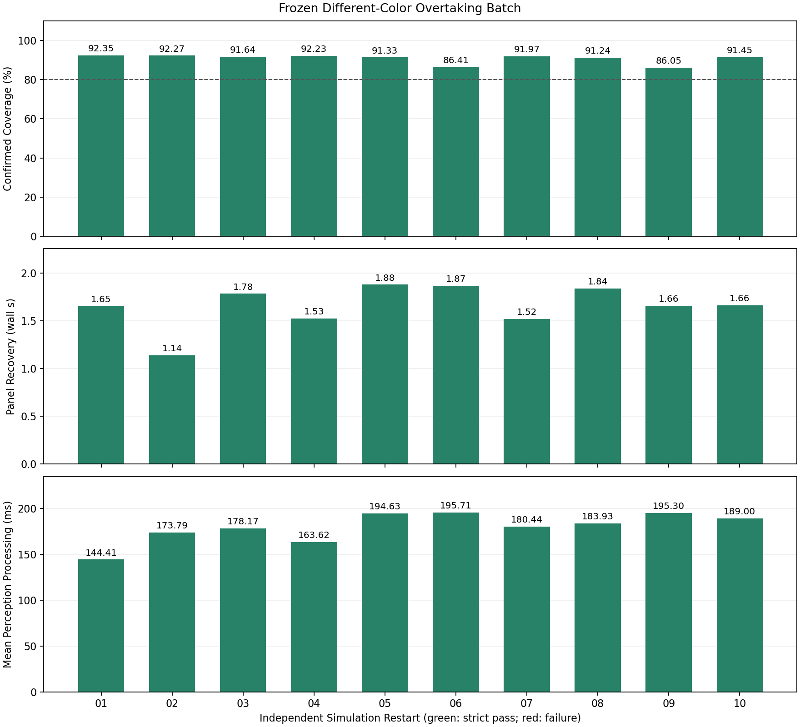

# 修复版无人机车辆跟踪批量实验总结

实验批次日期：2026-10-11。场景：红色目标车、蓝色干扰车、分车道超车及持续运动中的道路遮挡。

## 结论

完整执行 10 次独立重启，无替换、无补选、无未启动试次。任务、独立身份和严格联合均通过 10/10，全部自主返航、降落解锁，无可评分错车、身份切换、监督接管或记录到的 armed 安全事件。确认覆盖率均值 90.69%，样本标准差 2.39 个百分点，最差 86.05%。

8149 次场景请求全部成功，日志序号和回执一致性通过核验。原场景服务问题在本批得到重复验证，但仍有 7 次非计划丢失，最长恢复 6.70 秒。当前成果是可重复的本场景仿真闭环，不是全程零丢失、硬实时、YOLO mAP、同外观交叉或实机可靠性证明。

## 固定条件

- 原选择参考试次已清理；其配置、报告与执行源码证据保存在最终批次的 `reference_evidence/` 和 `reference_executed_sources/`。参考和此前开发试次不进入本批分母。
- 冻结 534 个文件、模型权重及实际 ROS 参数；感知、身份关联和控制算法未改。
- YOLO11s、Torch CPU、ROI、GMC、ByteTrack、原目标锁、截断滤波保护和尺度速度预测保留。
- 竞争恢复及控制平滑关闭；车速 0.8 m/s，遮挡起点 15 仿真秒、持续 4 仿真秒，带 GUI。
- 10 墙钟秒盲跟、4 m 恢复位移、0.8 m/s 恢复预测速度上限不变。
- 每次重启全部飞行与仿真进程，普通任务失败不重试；错车、安全事件或版本漂移按原协议停止。

## 逐次结果

| 试次 | 确认覆盖率 | 非计划丢失 | 道路遮挡确认恢复（墙钟秒） | 请求 / 失败 | 任务 / 身份 / 严格联合 |
| --- | --- | --- | --- | --- | --- |
| 01 | 92.35% | 1 | 1.652 | 916 / 0 | 全通过 |
| 02 | 92.27% | 1 | 1.142 | 820 / 0 | 全通过 |
| 03 | 91.64% | 0 | 1.785 | 794 / 0 | 全通过 |
| 04 | 92.23% | 0 | 1.528 | 826 / 0 | 全通过 |
| 05 | 91.33% | 1 | 1.881 | 774 / 0 | 全通过 |
| 06 | 86.41% | 2 | 1.867 | 841 / 0 | 全通过 |
| 07 | 91.97% | 0 | 1.522 | 782 / 0 | 全通过 |
| 08 | 91.24% | 1 | 1.840 | 793 / 0 | 全通过 |
| 09 | 86.05% | 1 | 1.660 | 824 / 0 | 全通过 |
| 10 | 91.45% | 0 | 1.662 | 779 / 0 | 全通过 |

## 统计

| 指标 | N | 均值 | 样本标准差 | 最差 |
| --- | --- | --- | --- | --- |
| 确认覆盖率 | 10 | 90.69% | 2.39 个百分点 | 86.05% |
| 非计划丢失 / 次 | 10 | 0.70 | 0.67 | 2 |
| 道路遮挡确认恢复 | 10 | 1.654 s | 0.222 s | 1.881 s |
| 平均横向像素误差 | 10 | 16.07 px | 5.86 px | 22.13 px |
| 横向像素误差 P95 | 10 | 31.37 px | 10.38 px | 40.01 px |
| 平均感知处理耗时 | 10 | 179.90 ms | 16.22 ms | 195.71 ms |
| 感知处理耗时 P95 | 10 | 233.45 ms | 52.31 ms | 319.38 ms |
| 单帧处理峰值 | 10 | 348.61 ms | 31.92 ms | 390.06 ms |
| 非计划恢复（事件级） | 7 | 2.158 s | 2.941 s | 6.700 s |
| 无人机跟随行进距离 | 10 | 51.73 m | 3.29 m | 最短 48.03 m |
| 报告车辆行进距离 | 10 | 64.46 m | 3.37 m | 最短 61.13 m |

所有试次级指标 N=10、无缺失。非计划恢复按 7 个事件计算；4 个没有非计划丢失的试次不补零，原主汇总的条件试次级恢复统计 N=6 与它不同。每次 P95 再跨试次汇总，不是所有帧的混合 P95。确认覆盖率是时间加权身份确认比例；像素误差仅针对确认观测；处理耗时不包含完整曝光到控制执行链路。

共 17 次 TRACK 丢失：10 次预设道路遮挡，7 次非计划；均恢复。采样盲窗最差 8.299 s，盲跟指令位移最差 2.372 m，属于离散补充审计。任务成功率的二项 Wilson 95% 参考区间约 72.25% 至 100%，有限确定性场景重复不能保证总体成功率 100%。

## 最差试次与剩余困难

本批没有失败任务，主目录 `failure_analysis.json` 验收失败计数为空；这不消除跟踪空档。

06 存在 6.202 s 非计划恢复。在该丢失区间内，15 个可唯一投影匹配原车的未确认候选中，11 个中心门控拒绝、4 个等待确认，部分拒绝还包含尺度或协方差理由。09 的 6.700 s 恢复中，同类候选 22 个，其中 18 个中心门控拒绝、4 个等待确认。邻域关联记录最大间隔分别约 1.194、1.151 s；各次感知处理均值约 195.71、195.30 ms。

其余 5 次短恢复约 0.200 至 0.703 s，控制丢失区间仍有已确认候选，不能统一解释为 YOLO 漏检。中心预测、观测新鲜度及重复确认时序仍是剩余困难。本轮不改算法、不统一放宽门限、不替换低覆盖率试次；包围体投影不是像素级可见性真值，记录相关性也不证明唯一根因。

## 完整性和限制

`completion_check.json` 确认完整性错误为空，10 个不同 PX4 启动 PID，源码、模型、ROS 参数、安装模块和 ULog 哈希一致。逐请求统计共创建 50 次、位姿更新 8099 次，全部成功；10 个独立服务子进程均退出。ULog armed failsafe、armed Offboard 信号丢失、dropout 和监督干预总数均为 0。

PX4 自动校准与累计状态没有强制清空：05、07、10 的记录初值 `CAL_BARO0_OFF=-1.220703125`，首轮为 `1.220703125`，飞行编号和累计时间也变化；其他记录到的飞控参数没有差异。不把 ROS 配置冻结写成全部 PX4 持久状态相同，未记录默认值也不能独立核验。

旧同外观交叉、开发试跑、中止及失败实验产物已按要求于 2026-10-11 清理，不能在当前工作区独立复核旧批次。本批十次全部保留，统计和原始记录未修改，也不代表整个开发过程成功率。本批不能与旧场景混算，不能用较容易的异色超车结果宣称同外观 ReID 已解决。没有新训练模型、实机部署、硬实时保证或环境泛化验证。清理清单见上级 `CLEANUP_MANIFEST.json`。

车辆相关回归 320 项通过、3 个 protobuf 弃用警告（4.87 s）；本轮不修改飞行包源码，安装模块与冻结源码一致。图表已人工检查，最终未发现残留 PX4、Gazebo、DDS Agent 或本批服务子进程。

## 文件索引

- 原始批量目录：`../scene_transport_isolated_repeat_20261011_01/`，试次 `overtaking_01/` 至 `overtaking_10/`。
- 主统计：该目录的 `study_summary.json`、`trials.csv`、`STUDY_REPORT.md`、`failure_analysis.json`。
- 原图与标注图：每个试次的 `*_raw.png`、`crossing_*_raw.png` 和 `*.jpg`；逐请求、身份、样本、关联日志及 ULog 同目录。
- 本目录 `final_metrics.json`：完整指标、事件级恢复、参数差异及输入哈希。
- `completion_check.json`、`latency_safety_audit.json`、`framing_audit.json`：独立完整性、时延、安全和构图审计。
- `scene_service_summary.json`、`scene_service_trials.csv`：全请求失败及耗时统计。
- `loss_windows/nonplanned_loss_audit.json`：逐非计划丢失、候选、投影校验和原始拒绝原因，附分析脚本副本。

项目整体架构、技术栈和当前成果见根目录 `PROJECT_OVERVIEW.md`；主要困难、方法及仍未解决的部分见 `PROJECT_CHALLENGES.md`。
